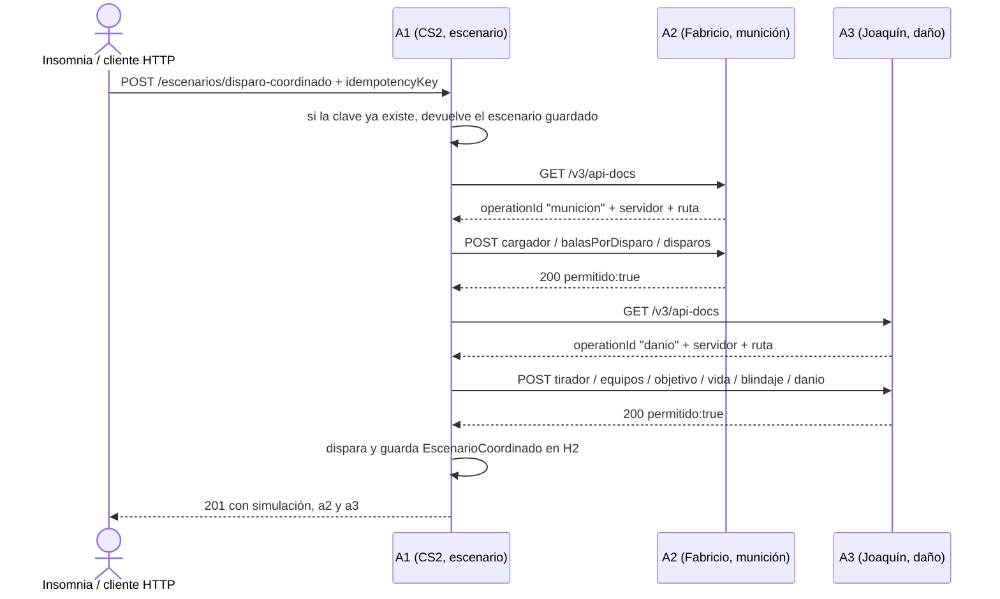
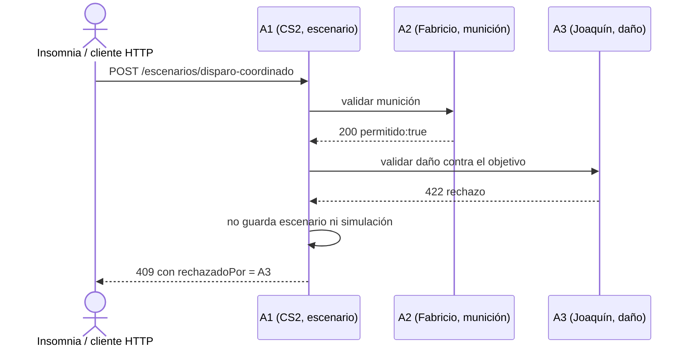

# POO-09 aplicado — Challenge de APIs cruzadas (CS2)

- **Slug:** `ejercicio-poo-09-apis-cruzadas-2026-11-16`
- **Asignatura:** Lenguaje de Programación 3 (CYT646)
- **Repositorio propio:** `https://github.com/MigueMedina/mmedina-tplp3-2026`
- **Proyecto:** `mmedina-tplp3-2026`, módulo `cs2/`
- **Paquete base:** `py.edu.uc.lp3.mm.cs2`
- **Stack:** Java 21, Spring Boot 4.1.1, springdoc-openapi 3.2.1, Spring Data JPA, H2, Maven Wrapper.

## Enunciados de referencia

- [Enunciado POO-09](https://github.com/alefq/afq-taller-git-2024/blob/main/docs/ejercicio-poo-09-apis-cruzadas-2026-11-16.md)
- [Grupos](https://github.com/alefq/afq-taller-git-2024/blob/main/docs/ejercicio-poo-09-grupos-2026-11-16.md)
- [Ejemplo UNO](https://github.com/alefq/afq-taller-git-2024/blob/main/docs/ejercicio-poo-09-ejemplo-uno-2026-11-16.md)

## Situación de POO-08

La corrección de POO-08 tuvo observaciones y **todas están cerradas**. El detalle
item por ítem está en `README.md`, sección «Estado de la corrección de POO-08».
El commit de cierre de observaciones de POO-08 es
[`4d67d6d`](https://github.com/MigueMedina/mmedina-tplp3-2026/commit/4d67d6db45af73423a9f19791ad4cb8700940213).
Por lo tanto, este ítem aporta los 3 puntos de POO-08 más los 12 del challenge.

No se vuelve a aplicar la rúbrica de 24 de POO-08. La defensa oral es otro
ejercicio de Classroom de 10 puntos y no se califica aquí.

## Mapa A1 / A2 / A3

A1 es este repositorio, A2 es Fabricio (`fg-taller-git-2026`) y A3 es Joaquín
(`jb-taller-git-2026`). Las variables de entorno permiten reemplazar las URLs
sin tocar código.

| Rol | Dueño | Juego | URL base | OpenAPI | Regla consultada en una frase |
|---|---|---|---|---|---|
| A1 | Este repositorio | Counter-Strike 2 | `http://localhost:8080` | `http://localhost:8080/v3/api-docs` | Orquesta el disparo coordinado y persiste la jugada cuando A2 y A3 aceptan. |
| A2 | Fabricio G. | Counter-Strike 2 | `A2_BASE_URL` / `http://localhost:8081` | `A2_OPENAPI_URL` / `http://localhost:8081/v3/api-docs` | `POST /api/reglas/municion` (`municion`) valida `cargador`, `balasPorDisparo` y `disparos`. |
| A3 | Joaquín B. | Counter-Strike 2 | `A3_BASE_URL` / `http://localhost:8082` | `A3_OPENAPI_URL` / `http://localhost:8082/v3/api-docs` | `POST /api/reglas/danio` (`danio`) valida tirador, equipos, vida, blindaje y daño del objetivo. |

Las rutas de los compañeros no están copiadas como constantes de dominio: se
resuelven en tiempo de ejecución desde cada OpenAPI. Los `operationId`
configurados por defecto son `municion` para A2 y `danio` para A3; ambos se
pueden cambiar por variable de entorno.

Para que el grupo pueda rotar, este servicio publica sus dos reglas con los
`operationId` propios `validarMunicion` y `validarJugadorVivo`:
`GET /api/reglas`, `POST /api/reglas/municion` y
`POST /api/reglas/jugador-vivo`. No usan repositorios ni escriben en H2. La
guía para quien nos consulte como A2 o A3 está en
`Docs/doc-para-companeros.md`.

## Escenario en una frase

Un cliente llama sólo a A1 con `POST /escenarios/disparo-coordinado`; A1 le
pregunta a A2 si hay munición (`municion`) y a A3 si el daño contra el objetivo
es legal (`danio`), y sólo si los dos responden 2xx con `permitido:true` guarda
en H2 la simulación, las dos aprobaciones y la fecha del escenario.

El cuerpo de A1 es
`{"jugadorId":1,"armaId":1,"equipoTirador":"TERRORISTAS","equipoObjetivo":"ANTITERRORISTAS","idempotencyKey":"escenario-001"}`;
los equipos son opcionales y por defecto el tirador es `TERRORISTAS` y el
objetivo `ANTITERRORISTAS`. Repetir la misma `idempotencyKey` devuelve el
escenario ya guardado sin consultar a los compañeros ni escribir de nuevo. El
cliente no necesita conocer las rutas ajenas: A1 construye los pedidos con lo que
dice cada OpenAPI, prefiere la `base-url` configurada y cachea la ruta 5 minutos.

## Criterios del challenge

| # | Criterio | Evidencia en este repositorio | Puntos |
|---|---|---|---|
| 1 | OpenAPI propio | `/v3/api-docs` y `/swagger-ui.html`; CRUD, simulación y errores 400/404/409 documentados con `@Tag`, `@Operation`, `@ApiResponses` y `@Schema`. | 0-3 |
| 2 | Round robin | Tabla A1/A2/A3 en este archivo y en el README; URLs configurables y reglas citadas en una frase. | 0-3 |
| 3 | Consumo | `OpenApiOperationResolver`, `CompaneroClient`, `ApiClientesProperties` y `ClientHttpConfig`: leen los OpenAPI, resuelven `operationId`, cachean la ruta con TTL, prefieren la base configurada, aplican timeouts/buffering y hacen HTTP real con `RestClient`. | 0-3 |
| 4 | Escenario persistido | `EscenarioController`, `EscenarioService`, `EscenarioCoordinado`, `EscenarioRepository`, `GET /escenarios` y `GET /escenarios/{id}`; HTTP fuera de la transacción, revalidación con `@Version`, idempotencia, rechazo 409 atribuido y sin escrituras. | 0-3 |
| 5 | Corrección POO-08 | Sección del README con cada observación y su cierre. | 3 |

## Flujo del escenario feliz



## Flujo de rechazo



Si quien rechaza es A2, A1 ni siquiera consulta a A3. En ambos casos la tabla
`ESCENARIOS` y el historial `SIMULACIONES` quedan exactamente como antes.

## Configuración de clientes

Archivo: `cs2/src/main/resources/application.properties`.

| Propiedad | Valor por defecto | Uso |
|---|---|---|
| `apis.a2.base-url` | `http://localhost:8081` | URL base de Fabricio (A2). |
| `apis.a2.openapi-url` | vacía | Si está vacía se deriva `/v3/api-docs` de la base. |
| `apis.a2.operation-id` | `municion` | Operación buscada en el documento de A2. |
| `apis.a2.cuerpo.*` | `cargador`, `balasPorDisparo`, `disparos` | Nombres de las claves del JSON enviado a A2. |
| `apis.a3.base-url` | `http://localhost:8082` | URL base de Joaquín (A3). |
| `apis.a3.openapi-url` | vacía | Si está vacía se deriva `/v3/api-docs` de la base. |
| `apis.a3.operation-id` | `danio` | Operación buscada en el documento de A3. |
| `apis.a3.cuerpo.*` | `tirador`, `equipoTirador`, `objetivo`, `equipoObjetivo`, `vidaObjetivo`, `blindajeObjetivo`, `danio` | Nombres de las claves del JSON enviado a A3. |
| `apis.connect-timeout` | `2s` | Timeout de conexión; variable `APIS_CONNECT_TIMEOUT`. |
| `apis.read-timeout` | `5s` | Timeout de lectura; variable `APIS_READ_TIMEOUT`. |

También se pueden pasar como variables de entorno, por ejemplo:

```bash
A2_BASE_URL=http://localhost:8081 \
A2_OPERATION_ID=municion \
A3_BASE_URL=http://localhost:8082 \
A3_OPERATION_ID=danio \
bash ./mvnw spring-boot:run
```

`OpenApiOperationResolver` guarda en caché la ruta resuelta por rol, operación y
URL del documento durante 5 minutos; luego la resuelve de nuevo. Si el compañero
cambia el nombre de la ruta pero actualiza su OpenAPI, A1 lo detecta en el próximo
refresco; no hay reglas copiadas de su código ni rutas escritas a mano en el
dominio. La `base-url` configurada gana sobre el `servers[0].url` remoto, y si
falta un mapeo de cuerpo configurado el cliente falla rápido.

### Mapa rápido de `operationId` y payload

- A1 consume de A2 `municion` con `cargador`, `balasPorDisparo` y `disparos`.
- A1 consume de A3 `danio` con `tirador`, `equipoTirador`, `objetivo`,
  `equipoObjetivo`, `vidaObjetivo`, `blindajeObjetivo` y `danio`.
- A1 expone para un compañero los aliases `/api/companeros/municion`
  (`operationId=municion`, payload `carga` y `dano`) y `/api/companeros/danio`
  (`operationId=danio`, payload `vida` y `blindaje`).
- Las reglas originales siguen en `/api/reglas/municion` y
  `/api/reglas/jugador-vivo`; los aliases reducen la asimetría sin romper esos
  contratos. `GET /api/catalogo` publica las stats orientativas de las armas.

## Cómo arrancar los tres servicios

A1 es este repositorio:

```bash
cd cs2
bash ./mvnw spring-boot:run
```

A2 es Fabricio:

```bash
git clone https://github.com/FabricioG29/fg-taller-git-2026.git a2
cd a2
bash ./mvnw spring-boot:run -Dspring-boot.run.arguments=--server.port=8081
```

A3 es Joaquín:

```bash
git clone https://github.com/joaquinBenegas0/jb-taller-git-2026.git a3
cd a3
PORT=8082 bash ./mvnw spring-boot:run
```

Si los compañeros usan otros puertos, cambiar `A2_BASE_URL` y `A3_BASE_URL` en
el arranque de A1.

## Cómo probarlo

1. Arrancar A1, A2 y A3.
2. Abrir los tres OpenAPI: `/v3/api-docs` en los puertos 8080, 8081 y 8082.
3. Importar `insomnia/cs2-insomnia.json` y revisar `insomnia/README.md`.
  4. Crear un jugador y un fusil con las carpetas `04 - Jugadores` y
     `02 - Fusiles` de POO-08.
  5. Ejecutar `10 - POO-09 (APIs cruzadas)` en el orden indicado: catálogo,
     aliases de `operationId`, OpenAPI propios y ajenos, validación 400,
     escenario feliz, GET del escenario, rechazo de A2, rechazo de A3 y GET de
     comparación.
  6. Repetir el escenario feliz con la misma `idempotencyKey`: debe devolver el
     mismo `id` y no consultar a los compañeros.
  7. Comparar las respuestas con:
     - `insomnia/respuestas/escenario-feliz.http`
     - `insomnia/respuestas/rechazo-a2.http`
     - `insomnia/respuestas/rechazo-a3.http`
     - `insomnia/respuestas/companero-no-disponible.http`
     - `insomnia/respuestas/validacion-400.http`
  8. En H2, verificar `ESCENARIOS` y `SIMULACIONES`: crecen una sola vez, en el
     caso feliz, y no cambian después de los rechazos, la validación ni la
     repetición idempotente.
  9. Para regenerar la evidencia real de los tres servicios, ejecutar
     `bash insomnia/capturar-respuestas.sh`; deja 21 pedidos con su status y
     cuerpo en `insomnia/respuestas/capturas/` y un índice en `resumen.md`.


## Cómo se atribuye el error

`CompanneroRechazoException` guarda el rol, el código HTTP y el cuerpo que mandó
el compañero. `GlobalExceptionHandler` responde 409 con:

```json
{
  "excepcion": "CompanneroRechazoException",
  "mensaje": "Rechazo de A3 (HTTP 422)",
  "rechazadoPor": "A3",
  "statusRemoto": 422,
  "cuerpoRemoto": "{\"codigo\":\"DISPARO_NO_PERMITIDO\",\"mensaje\":\"El objetivo ya fue eliminado\"}"
}
```

Así el cliente distingue «falló A2» de «falló A3» sin leer código ajeno. Un 200
con `permitido:false` también se considera rechazo del rol correspondiente.

## Si un compañero no responde

- El cliente tiene timeouts de 2 y 5 segundos configurables con
  `APIS_CONNECT_TIMEOUT` y `APIS_READ_TIMEOUT`; las respuestas se leen con buffering.
- Un fallo de red o un 5xx se traduce a `CompaneroNoDisponibleException`, que el
  handler convierte en 502 (o 504 si el remoto devolvió 504) con `traceId`,
  `statusRemoto` y `cuerpoRemoto`.
- Las consultas HTTP ocurren fuera de la transacción; justo antes de escribir se
  releen las entidades y un cambio concurrente produce 409 por `@Version`.
- El repositorio deja respuestas de ejemplo en `insomnia/respuestas/` para que
  la corrección pueda verificar el feliz, cada rechazo y la no disponibilidad
  aunque A2 o A3 estén apagados. Además, `insomnia/capturar-respuestas.sh`
  regenera respuestas reales de los tres servicios con pedido, URL, status y
  cuerpo; el índice está en `insomnia/respuestas/capturas/resumen.md`.

## Pruebas automatizadas

```bash
cd cs2
bash ./mvnw clean test
```

Cubren:

- generación del documento OpenAPI 3.0 y presencia de operaciones/errores;
- consultas stateless de las dos reglas propias, con casos 200, 400 y 409;
- resolución de rutas desde un `/v3/api-docs` simulado, `servers`, caché con
  invalidación, fail-fast de mapeos y cliente contra un HTTP server real;
- conversión de rechazos 409 y de fallos 5xx a no disponible 502;
- escenario feliz, aprobación semántica `permitido`, rechazos A2/A3 e
  idempotencia en el servicio, sin escrituras indebidas;
- bloqueo optimista con `@Version` e integridad referencial del escenario;
- catálogo CS2 expuesto por HTTP y aliases con los `operationId` `municion` y
  `danio`,
- escenario por HTTP con `GET` posterior, 400 de validación con `campo` y
  `errores`, 502 sin escrituras y cuerpo 409 con `rechazadoPor`,
- error tipado para parámetros de ruta mal tipados en vez de 500.

## Entrega

El enlace exacto al commit de la solución se informa en Classroom y se replica
en el README con la convención del commit anterior: un commit no puede contener
su propio hash, por lo que el README apunta al commit inmediatamente anterior al
cierre documental.

- Commit exacto de POO-08:
  [`4d67d6d`](https://github.com/MigueMedina/mmedina-tplp3-2026/commit/4d67d6db45af73423a9f19791ad4cb8700940213).
- Commit exacto de POO-09:
  [`0d93ffe`](https://github.com/MigueMedina/mmedina-tplp3-2026/commit/0d93ffe8f04f797e75ea76a3494dfc1d1190f7f6).
