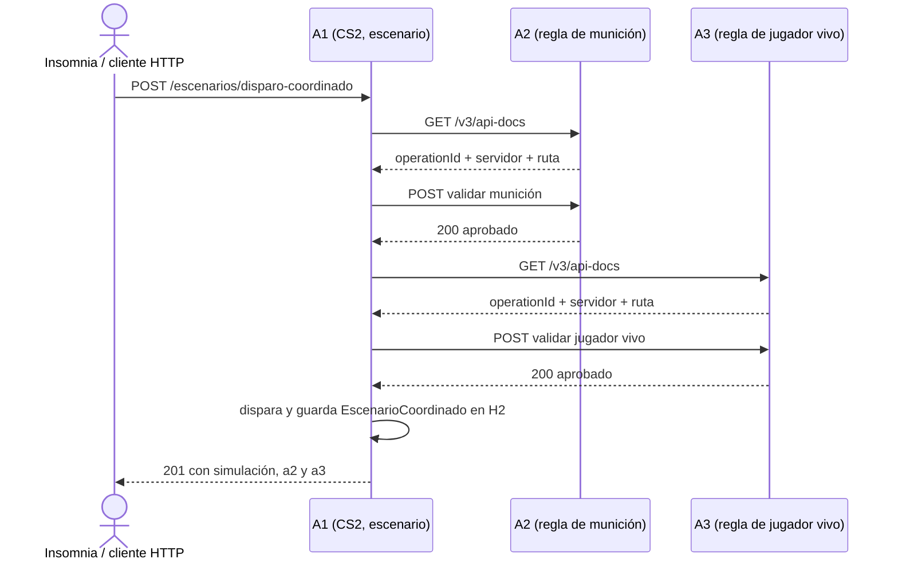
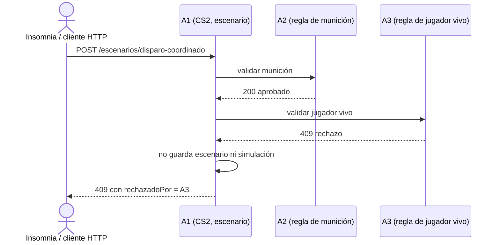

# POO-09 aplicado — Challenge de APIs cruzadas (CS2)

- **Slug:** `ejercicio-poo-09-apis-cruzadas-2026-11-16`
- **Asignatura:** Lenguaje de Programación 3 (CYT646)
- **Repositorio propio:** `https://github.com/MigueMedina/mmedina-tplp3-2026`
- **Proyecto:** `mmedina-tplp3-2026`, módulo `cs2/`
- **Paquete base:** `py.edu.uc.lp3.mm.cs2`
- **Stack:** Java 21, Spring Boot 4.1.1, springdoc-openapi 3.2.1, Spring Data JPA, H2, Maven Wrapper.

## Enunciados de referencia

- [Enunciado POO-09](https://github.com/alefq/afq-taller-git-2024/blob/main/docs/ejercicio-poo-09-apis-cruzadas-2026-11-16.md)
- [Grupos](https://github.com/alefq/afq-taller-git-2024/blob/main/docs/ejercicio-poo-09-grupos-2026-11-16.md)
- [Ejemplo UNO](https://github.com/alefq/afq-taller-git-2024/blob/main/docs/ejercicio-poo-09-ejemplo-uno-2026-11-16.md)

## Situación de POO-08

La corrección de POO-08 tuvo observaciones y **todas están cerradas**. El detalle
item por ítem está en `README.md`, sección «Estado de la corrección de POO-08».
El commit de cierre de observaciones de POO-08 es
[`4d67d6d`](https://github.com/MigueMedina/mmedina-tplp3-2026/commit/4d67d6db45af73423a9f19791ad4cb8700940213).
Por lo tanto, este ítem aporta los 3 puntos de POO-08 más los 12 del challenge.

No se vuelve a aplicar la rúbrica de 24 de POO-08. La defensa oral es otro
ejercicio de Classroom de 10 puntos y no se califica aquí.

## Mapa A1 / A2 / A3

Los datos de A2 y A3 se completan con los compañeros del grupo CS2 acordado.
Hasta entonces quedan como placeholders y las variables de entorno permiten
reemplazarlos sin tocar código.

| Rol | Dueño | Juego | URL base | OpenAPI | Regla consultada en una frase |
|---|---|---|---|---|---|
| A1 | Este repositorio | Counter-Strike 2 | `http://localhost:8080` | `http://localhost:8080/v3/api-docs` | Orquesta el disparo coordinado y persiste la jugada cuando A2 y A3 aceptan. |
| A2 | **Pendiente de grupo CS2** | Counter-Strike 2 | `A2_BASE_URL` / `http://localhost:8081` | `A2_OPENAPI_URL` / `http://localhost:8081/v3/api-docs` | Valida que el arma tenga munición suficiente para el disparo. |
| A3 | **Pendiente de grupo CS2** | Counter-Strike 2 | `A3_BASE_URL` / `http://localhost:8082` | `A3_OPENAPI_URL` / `http://localhost:8082/v3/api-docs` | Valida que el jugador objetivo siga vivo. |

Las rutas de los compañeros no están copiadas como constantes de dominio: se
resuelven en tiempo de ejecución desde cada OpenAPI. Los `operationId`
configurados por defecto son `validarMunicion` para A2 y `validarJugadorVivo`
para A3; ambos se pueden cambiar por variable de entorno.

Para que el grupo pueda rotar, este servicio publica sus dos reglas con esos
mismos `operationId`: `GET /api/reglas`, `POST /api/reglas/municion` y
`POST /api/reglas/jugador-vivo`. No usan repositorios ni escriben en H2. La
ficha para quien nos consulte como A2 o A3 está en `Docs/PARA-COMPANEROS.md`.

## Escenario en una frase

Un cliente llama sólo a A1 con `POST /escenarios/disparo-coordinado`; A1 le
pregunta a A2 si el arma tiene munición y a A3 si el jugador está vivo, y sólo si
los dos aceptan guarda en H2 la simulación, las dos aprobaciones y la fecha del
escenario.

El lugar del cuerpo de A1 es `{"jugadorId":1,"armaId":1}`. El cliente no necesita
conocer las rutas ajenas: A1 construye los pedidos con lo que dice cada OpenAPI.

## Criterios del challenge

| # | Criterio | Evidencia en este repositorio | Puntos |
|---|---|---|---|
| 1 | OpenAPI propio | `/v3/api-docs` y `/swagger-ui.html`; CRUD, simulación y errores 400/404/409 documentados con `@Tag`, `@Operation`, `@ApiResponses` y `@Schema`. | 0-3 |
| 2 | Round robin | Tabla A1/A2/A3 en este archivo y en el README; URLs configurables y reglas citadas en una frase. | 0-3 |
| 3 | Consumo | `OpenApiOperationResolver`, `CompaneroClient`, `ApiClientesProperties` y `ClientHttpConfig`: leen los OpenAPI, resuelven `operationId`, cachean la ruta y hacen HTTP real con `RestClient`. | 0-3 |
| 4 | Escenario persistido | `EscenarioController`, `EscenarioService`, `EscenarioCoordinado`, `EscenarioRepository`, `GET /escenarios` y `GET /escenarios/{id}`; rechazo 409 atribuido a A2 o A3 y sin escrituras. | 0-3 |
| 5 | Corrección POO-08 | Sección del README con cada observación y su cierre. | 3 |

## Flujo del escenario feliz



## Flujo de rechazo



Si quien rechaza es A2, A1 ni siquiera consulta a A3. En ambos casos la tabla
`ESCENARIOS` y el historial `SIMULACIONES` quedan exactamente como antes.

## Configuración de clientes

Archivo: `cs2/src/main/resources/application.properties`.

| Propiedad | Valor por defecto | Uso |
|---|---|---|
| `apis.a2.base-url` | `http://localhost:8081` | URL base de A2. |
| `apis.a2.openapi-url` | vacía | Si está vacía se deriva `/v3/api-docs` de la base. |
| `apis.a2.operation-id` | `validarMunicion` | Operación buscada en el documento de A2. |
| `apis.a2.request.*` | nombres de BodyDto | Permite adaptar los nombres de campos del JSON sin cambiar Java. |
| `apis.a3.base-url` | `http://localhost:8082` | URL base de A3. |
| `apis.a3.openapi-url` | vacía | Si está vacía se deriva `/v3/api-docs` de la base. |
| `apis.a3.operation-id` | `validarJugadorVivo` | Operación buscada en el documento de A3. |
| `apis.a3.request.*` | nombres de BodyDto | Permite adaptar los nombres de campos del JSON sin cambiar Java. |

También se pueden pasar como variables de entorno, por ejemplo:

```bash
A2_BASE_URL=http://localhost:8081 \
A2_OPERATION_ID=validarMunicion \
A3_BASE_URL=http://localhost:8082 \
A3_OPERATION_ID=validarJugadorVivo \
bash ./mvnw spring-boot:run
```

`OpenApiOperationResolver` guarda en caché la ruta resuelta por rol, operación y
URL del documento. Si el compañero cambia el nombre de la ruta pero actualiza su
OpenAPI, A1 vuelve a resolverlo desde el documento; no hay reglas copiadas de su
código ni rutas escritas a mano en el dominio.

## Cómo arrancar los tres servicios

A1 es este repositorio:

```bash
cd cs2
bash ./mvnw spring-boot:run
```

A2 y A3 son repositorios de los compañeros. Cuando se confirme el grupo, el
README debe reemplazar estos marcadores por los enlaces reales:

```bash
git clone <URL_REPO_A2> a2
cd a2
./mvnw spring-boot:run -Dspring-boot.run.arguments=--server.port=8081
```

```bash
git clone <URL_REPO_A3> a3
cd a3
./mvnw spring-boot:run -Dspring-boot.run.arguments=--server.port=8082
```

Si los compañeros usan otros puertos, cambiar `A2_BASE_URL` y `A3_BASE_URL` en
el arranque de A1.

## Cómo probarlo

1. Arrancar A1, A2 y A3.
2. Abrir los tres OpenAPI: `/v3/api-docs` en los puertos 8080, 8081 y 8082.
3. Importar `insomnia/cs2-insomnia.json` y revisar `insomnia/README.md`.
4. Crear un jugador y un fusil con las carpetas `04 - Jugadores` y
   `02 - Fusiles` de POO-08.
5. Ejecutar `10 - POO-09 (APIs cruzadas)` en el orden indicado:
   OpenAPI propios y ajenos, escenario feliz, GET del escenario, rechazo de A2,
   rechazo de A3 y GET de comparación.
6. Comparar las respuestas con:
   - `insomnia/respuestas/escenario-feliz.http`
   - `insomnia/respuestas/rechazo-a2.http`
   - `insomnia/respuestas/rechazo-a3.http`
7. En H2, verificar `ESCENARIOS` y `SIMULACIONES`: crecen una sola vez, en el
   caso feliz, y no cambian después de los rechazos.

## Cómo se atribuye el error

`CompanneroRechazoException` guarda el rol, el código HTTP y el cuerpo que mandó
el compañero. `GlobalExceptionHandler` responde 409 con:

```json
{
  "excepcion": "CompanneroRechazoException",
  "mensaje": "Rechazo de A3 (HTTP 409)",
  "rechazadoPor": "A3",
  "statusRemoto": 409,
  "cuerpoRemoto": "{\"excepcion\":\"JugadorEliminadoException\"}"
}
```

Así el cliente distingue «falló A2» de «falló A3» sin leer código ajeno.

## Si un compañero no responde

- El cliente tiene timeouts de 2 y 5 segundos configurados en `ClientHttpConfig`.
- Un fallo de red o una respuesta no 2xx se traduce a
  `CompanneroRechazoException` con el rol correspondiente.
- El repositorio deja respuestas de ejemplo en `insomnia/respuestas/` para que
  la corrección pueda verificar el feliz y cada rechazo aunque A2 o A3 estén
  apagados.

## Pruebas automatizadas

```bash
cd cs2
bash ./mvnw clean test
```

Cubren:

- generación del documento OpenAPI 3.0 y presencia de operaciones/errores;
- consultas stateless de las dos reglas propias, con casos 200, 400 y 409;
- resolución de rutas desde un `/v3/api-docs` simulado y uso de `servers`;
- construcción del cliente por rol y conversión de rechazos;
- escenario feliz y rechazos A2/A3 en el servicio, sin escrituras;
- escenario por HTTP con `GET` posterior y cuerpo 409 con `rechazadoPor`.

## Entrega

El enlace exacto al commit de la solución se informa en Classroom y se replica
en el README con la convención del commit anterior: un commit no puede contener
su propio hash, por lo que el README apunta al commit inmediatamente anterior al
cierre documental.

- Commit exacto de POO-08:
  [`4d67d6d`](https://github.com/MigueMedina/mmedina-tplp3-2026/commit/4d67d6db45af73423a9f19791ad4cb8700940213).
- Commit exacto de POO-09:
  [`992121d`](https://github.com/MigueMedina/mmedina-tplp3-2026/commit/992121d6805984ec26e544e138e5092c9ae07be5).
