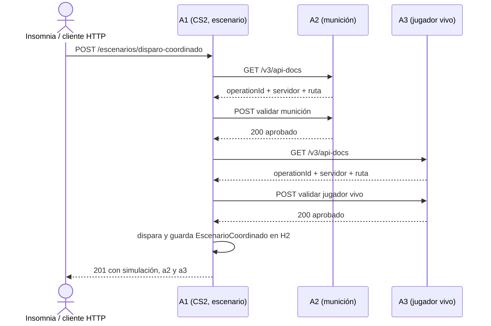
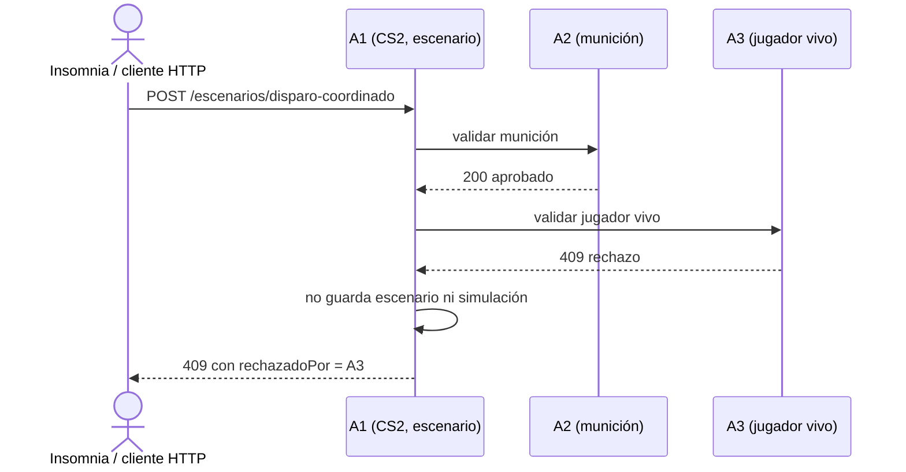

```mermaid
classDiagram
    direction LR

    class Arma {
        <<abstract, @Entity>>
        -int id
        -String nombre
        -double precio
        +disparar() String
        +recargar() String
        +obtenerDetalleTienda() String
    }

    class ArmaDeFuego {
        <<abstract, @Entity>>
        -int dano
        -int precision
        -double recarga
        -double velocidad
        -int municionActual
        -int capacidadCargador
        -int cargadoresRestantes
        +getDano() int
        +getMunicionActual() int
        +getCargadoresRestantes() int
        +recargar() String
        +recargar(int) String
    }

    class Arrojadiza {
        <<abstract, @Entity>>
        -String tipo
        -double radio
        -double distancia
        -double duracion
        -double cooldown
        +getRango() double
        +recargar() String
    }

    class Fusil
    class Pistola
    class Escopeta
    class AWP
    class Flash
    class Humo
    class Granada

    class UICapable {
        <<interface>>
        +getImagen() String
        +getSonido() String
        +getVelocidadDisparo() double
        +getRango() double
        +mostrarEnUI() String
    }

    class ArmaOfensiva {
        <<interface>>
        +getDano() int
    }

    class Jugador {
        <<@Entity>>
        -Long id
        -String nombre
        -int vida
        -boolean vivo
        -Chaleco chaleco
        +recibirDisparo(int) int
        +equiparChaleco(Chaleco) void
        +getBlindaje() int
        +isVivo() boolean
        +revivir() void
    }

    class Chaleco {
        <<@Entity>>
        -Long id
        -int durabilidad
        +absorber(int) int
        +getDurabilidad() int
    }

    class Simulacion {
        <<@Entity>>
        -Long id
        -Jugador jugador
        -Arma arma
        -int dano
        -int vidaAntes
        -int vidaDespues
        -LocalDateTime fecha
    }

    class EscenarioCoordinado {
        <<@Entity>>
        -Long id
        -Simulacion simulacion
        -int a2Status
        -int a3Status
        -String a2Operacion
        -String a3Operacion
        -LocalDateTime fecha
    }

    class ArmaRepository {
        <<interface>>
        +findAllByOrderByIdAsc()
        +findByNombreContainingIgnoreCaseOrderByIdAsc(String)
    }
    class FusilRepository { <<interface>> }
    class GranadaRepository { <<interface>> }
    class JugadorRepository { <<interface>> }
    class SimulacionRepository { <<interface>> }
    class EscenarioRepository { <<interface>> }

    class ArmaCrudController
    class JugadorController
    class SimulacionController
    class UIController
    class EscenarioController

    class ArmaMapper
    class ArmaService
    class FusilService
    class GranadaService
    class JugadorService
    class SimulacionService
    class UICapableService
    class ValidadorService
    class EscenarioService

    class RolCompanero {
        <<enumeration>>
        A2
        A3
    }
    class OpenApiOperationResolver
    class CompaneroClient

    class DomainException {
        <<abstract>>
    }
    class DatosInvalidosException
    class RecursoNoEncontradoException
    class MunicionInsuficienteException
    class JugadorEliminadoException
    class CompanneroRechazoException
    class GlobalExceptionHandler

    Arma <|-- ArmaDeFuego
    Arma <|-- Arrojadiza
    ArmaDeFuego <|-- Fusil
    ArmaDeFuego <|-- Pistola
    ArmaDeFuego <|-- Escopeta
    ArmaDeFuego <|-- AWP
    Arrojadiza <|-- Flash
    Arrojadiza <|-- Humo
    Arrojadiza <|-- Granada

    UICapable <|.. Fusil
    UICapable <|.. AWP
    UICapable <|.. Flash
    UICapable <|.. Granada
    UICapable <|.. Jugador
    ArmaOfensiva <|.. ArmaDeFuego
    ArmaOfensiva <|.. Granada

    DomainException <|-- DatosInvalidosException
    DomainException <|-- RecursoNoEncontradoException
    DomainException <|-- MunicionInsuficienteException
    DomainException <|-- JugadorEliminadoException
    DomainException <|-- CompanneroRechazoException

    Jugador "0..1" o-- "1" Chaleco : usa
    Jugador "1" --> "*" Simulacion : participa
    Arma "1" --> "*" Simulacion : se usa en
    Simulacion "1" --> "0..1" EscenarioCoordinado : se registra en

    ArmaCrudController --> ArmaService
    ArmaCrudController --> FusilService
    ArmaCrudController --> GranadaService
    JugadorController --> JugadorService
    SimulacionController --> SimulacionService
    UIController --> UICapableService
    ArmaService --> ArmaRepository
    ArmaService --> ArmaMapper
    FusilService --> FusilRepository
    FusilService --> ArmaMapper
    GranadaService --> GranadaRepository
    GranadaService --> ArmaMapper
    JugadorService --> JugadorRepository
    SimulacionService --> SimulacionRepository
    SimulacionService --> ArmaRepository
    SimulacionService --> JugadorRepository
    UICapableService --> ArmaRepository
    UICapableService --> JugadorRepository
    ArmaService --> ValidadorService
    FusilService --> ValidadorService
    GranadaService --> ValidadorService
    JugadorService --> ValidadorService
    SimulacionService --> ValidadorService
    ValidadorService ..> DatosInvalidosException : lanza
    GlobalExceptionHandler ..> DomainException

    EscenarioController --> EscenarioService
    EscenarioService --> EscenarioRepository
    EscenarioService --> SimulacionService
    EscenarioService --> CompaneroClient
    CompaneroClient --> OpenApiOperationResolver
    CompaneroClient --> RolCompanero
    EscenarioService ..> CompanneroRechazoException
    GlobalExceptionHandler ..> CompanneroRechazoException
```

Las validaciones, las reglas y las excepciones viven en la capa `service`
(`ValidadorService` y `SimulacionService`). Las entidades solo conservan el
estado encapsulado y exponen mensajes como `recibirDisparo()` o `recargar()` para
modificarlo.

## Escenario POO-09: camino feliz

## Escenario POO-09: rechazo de un compañero

