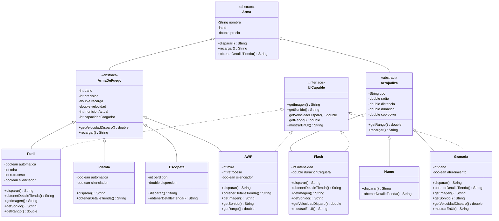

# Counter-Strike 2 (CS2) - API de Armas

Proyecto de ejemplo de la cátedra **LP3** (Universidad Católica "Nuestra Señora de la Asunción").

Modela el dominio de armas de *Counter-Strike 2* aplicando los pilares de la
Programación Orientada a Objetos (abstracción, encapsulamiento, herencia,
polimorfismo e interfaces) y lo expone mediante una **API REST** construida con
**Spring Boot**.

- **Paquete base:** `py.edu.uc.lp3.mm.cs2`
- **Java:** 21
- **Spring Boot:** 4.1.1
- **Build:** Maven (wrapper `./mvnw`, no es necesario instalar Maven)

---

## Estructura del proyecto

```
cs2/
├── pom.xml
├── mvnw / mvnw.cmd
└── src
    ├── main
    │   ├── java/py/edu/uc/lp3/mm/cs2
    │   │   ├── Cs2Application.java
    │   │   ├── constants/
    │   │   │   └── ApiPaths.java
    │   │   ├── domain/
    │   │   │   ├── Arma.java            (abstracta, raíz de la jerarquía)
    │   │   │   ├── ArmaDeFuego.java     (abstracta)
    │   │   │   ├── Arrojadiza.java      (abstracta)
    │   │   │   ├── UICapable.java       (interfaz)
    │   │   │   ├── Fusil.java
    │   │   │   ├── Pistola.java
    │   │   │   ├── Escopeta.java
    │   │   │   ├── AWP.java
    │   │   │   ├── Flash.java
    │   │   │   ├── Humo.java
    │   │   │   └── Granada.java
    │   │   └── rest/
    │   │       ├── controller/
    │   │       │   ├── IndexController.java
    │   │       │   ├── ArmaController.java
    │   │       │   └── UIController.java
    │   │       └── response/
    │   │           └── UIElementResponse.java
    │   └── resources/
    │       └── application.properties
    └── test/java/py/edu/uc/lp3/mm/cs2
        └── Cs2ApplicationTests.java
```

---

## Diagrama de clases



### Conceptos aplicados

- **Abstracción:** `Arma` define el contrato (`disparar`, `recargar`,
  `obtenerDetalleTienda`) que toda arma debe cumplir.
- **Herencia:** `ArmaDeFuego` y `Arrojadiza` extienden `Arma`; las armas
  concretas extienden una de esas dos familias.
- **Polimorfismo:** `/arma/accion` y `/ui-capables` trabajan con referencias de
  tipo `Arma` y `UICapable` sin conocer la clase concreta.
- **Encapsulamiento:** atributos `private` con getters/setters.
- **Interfaces:** `UICapable` es implementada por `Fusil`, `AWP`, `Flash` y
  `Granada`, que aportan imagen, sonido, velocidad de disparo y rango.

---

## Requisitos

- **JDK 21** instalado (`java -version`).
- No hace falta instalar Maven: el proyecto incluye el wrapper `mvnw`.

---

## Guía de ejecución

Todos los comandos se ejecutan dentro de la carpeta `cs2`:

```bash
cd cs2
```

### 1. Compilar

```bash
./mvnw clean compile
```

### 2. Ejecutar la aplicación

```bash
./mvnw spring-boot:run
```

La API queda disponible en `http://localhost:8080`.

### 3. Detener la aplicación

Presionar `Ctrl + C` en la terminal donde corre.

---

## Ejecutar las pruebas

```bash
./mvnw test
```

Resultado esperado: `BUILD SUCCESS`, con el test de contexto
`Cs2ApplicationTests.contextLoads()` en verde.

---

## Documentación interactiva (Swagger UI)

Con la aplicación en ejecución:

- **Swagger UI:** `http://localhost:8080/swagger-ui/index.html`
- **OpenAPI JSON:** `http://localhost:8080/v3/api-docs`

---

## Endpoints

| Método | Ruta            | Descripción                                                              |
|--------|-----------------|--------------------------------------------------------------------------|
| GET    | `/`             | Saludo de prueba.                                                        |
| GET    | `/ui-capables`  | Lista los elementos que implementan `UICapable` como `UIElementResponse`. |
| GET    | `/arma`         | Crea y devuelve un arma según el parámetro `tipo`.                        |
| GET    | `/arma/accion`  | Crea un arma y devuelve su recarga (`recargar()`) y detalle de tienda.    |

### Tipos soportados en `tipo`

`pistola` (por defecto), `fusil`, `awp`, `flash` y `granada`. Cualquier otro
valor cae en `pistola`.

> Nota: las clases `Escopeta` y `Humo` existen en el dominio, pero no están
> expuestas por `/arma`.

### Parámetros de `/arma` y `/arma/accion`

Todos son obligatorios salvo `tipo` (que por defecto es `pistola`).

| Parámetro           | Tipo    | Usado por                                     |
|---------------------|---------|-----------------------------------------------|
| `tipo`              | String  | selector de clase                             |
| `nombre`            | String  | todas                                         |
| `id`                | int     | todas                                         |
| `precio`            | double  | todas                                         |
| `dano`              | int     | fusil, awp, pistola, granada                  |
| `precision`         | int     | fusil, awp, pistola                           |
| `recarga`           | double  | fusil, awp, pistola                           |
| `velocidad`         | double  | fusil, awp, pistola                           |
| `capacidadCargador` | int     | fusil, awp, pistola                           |
| `automatica`        | boolean | fusil, pistola (en granada => `aturdimiento`) |
| `silenciador`       | boolean | fusil, awp, pistola                           |
| `mira`              | int     | fusil, awp                                    |
| `retroceso`         | int     | fusil, awp                                    |
| `radio`             | double  | flash, granada                                |
| `duracionCeguera`   | double  | flash                                         |
| `intensidad`        | int     | flash                                         |

---

## Ejemplos de uso

### 1. Saludo

```bash
curl http://localhost:8080/
```

```
Hola Mundo
```

### 2. Elementos de UI (`UICapable`)

```bash
curl http://localhost:8080/ui-capables
```

```json
[
  {"tipo":"Fusil","imagen":"fusil_ak-47.png","sonido":"fusil_disparo.ogg","velocidadDisparo":10.0,"rango":30.0,"mensaje":"Mostrando fusil_ak-47.png con sonido fusil_disparo.ogg (velocidad de disparo 10.0, rango 30.0)"},
  {"tipo":"Flash","imagen":"flash_flashbang.png","sonido":"flash_cegadora.ogg","velocidadDisparo":2.0,"rango":20.0,"mensaje":"¡Flashbang impacta en pantalla con intensidad 90 y ceguera de 3.5s!"},
  {"tipo":"AWP","imagen":"awp_awp.png","sonido":"awp_disparo.ogg","velocidadDisparo":5.0,"rango":100.0,"mensaje":"Mostrando awp_awp.png con sonido awp_disparo.ogg (velocidad de disparo 5.0, rango 100.0)"},
  {"tipo":"Granada","imagen":"granada_he_grenade.png","sonido":"granada_explosion.ogg","velocidadDisparo":1.0,"rango":30.0,"mensaje":"¡HE Grenade explosiona con 98 de daño y aturde al enemigo!"}
]
```

### 3. Crear un arma (`/arma`)

Pistola (tipo por defecto):

```bash
curl "http://localhost:8080/arma?tipo=pistola&nombre=USP&id=1&precio=200&dano=35&precision=80&recarga=2.2&velocidad=8&capacidadCargador=12&automatica=false&silenciador=true&mira=0&retroceso=10&radio=0&duracionCeguera=0&intensidad=0"
```

```json
{"nombre":"USP","id":1,"precio":200.0,"dano":35,"precision":80,"recarga":2.2,"velocidad":8.0,"capacidadCargador":12,"automatica":false,"silenciador":true,"municionActual":12,"velocidadDisparo":8.0}
```

Fusil:

```bash
curl "http://localhost:8080/arma?tipo=fusil&nombre=AK-47&id=1&precio=2700&dano=36&precision=75&recarga=2.5&velocidad=10&capacidadCargador=30&automatica=true&silenciador=false&mira=2&retroceso=20&radio=0&duracionCeguera=0&intensidad=0"
```

```json
{"automatica":true,"capacidadCargador":30,"dano":36,"id":1,"imagen":"fusil_ak-47.png","mira":2,"municionActual":30,"nombre":"AK-47","precio":2700.0,"precision":75,"rango":30.0,"recarga":2.5,"retroceso":20,"silenciador":false,"sonido":"fusil_disparo.ogg","velocidad":10.0,"velocidadDisparo":10.0}
```

AWP:

```bash
curl "http://localhost:8080/arma?tipo=awp&nombre=AWP&id=3&precio=4750&dano=115&precision=98&recarga=3.7&velocidad=5&capacidadCargador=10&automatica=false&silenciador=false&mira=2&retroceso=30&radio=0&duracionCeguera=0&intensidad=0"
```

```json
{"capacidadCargador":10,"dano":115,"id":3,"imagen":"awp_awp.png","mira":2,"municionActual":10,"nombre":"AWP","precio":4750.0,"precision":98,"rango":100.0,"recarga":3.7,"retroceso":30,"silenciador":false,"sonido":"awp_disparo.ogg","velocidad":5.0,"velocidadDisparo":5.0}
```

Granada:

```bash
curl "http://localhost:8080/arma?tipo=granada&nombre=HE&id=4&precio=300&dano=98&precision=0&recarga=0&velocidad=0&capacidadCargador=0&automatica=true&silenciador=false&mira=0&retroceso=0&radio=6&duracionCeguera=0&intensidad=0"
```

```json
{"aturdimiento":true,"cooldown":0.0,"dano":98,"distancia":0.0,"duracion":0.0,"id":4,"imagen":"granada_he.png","nombre":"HE","precio":300.0,"radio":6.0,"rango":0.0,"sonido":"granada_explosion.ogg","tipo":"granada","velocidadDisparo":0.0}
```

Flash:

```bash
curl "http://localhost:8080/arma?tipo=flash&nombre=Flashbang&id=2&precio=200&dano=0&precision=0&recarga=0&velocidad=0&capacidadCargador=0&automatica=false&silenciador=false&mira=0&retroceso=0&radio=5&duracionCeguera=3.5&intensidad=90"
```

### 4. Acción del arma (`/arma/accion`)

Devuelve un objeto con `arma_generada`, `mensaje_recarga` y `mensaje_tienda`.

```bash
curl "http://localhost:8080/arma/accion?tipo=fusil&nombre=AK-47&id=1&precio=2700&dano=36&precision=75&recarga=2.5&velocidad=10&capacidadCargador=30&automatica=true&silenciador=false&mira=2&retroceso=20&radio=0&duracionCeguera=0&intensidad=0"
```

```json
{
  "mensaje_tienda": "Fusil: AK-47 | Daño: 36 | Precio: $2700.0",
  "arma_generada": {
    "automatica": true, "capacidadCargador": 30, "dano": 36, "id": 1,
    "imagen": "fusil_ak-47.png", "mira": 2, "municionActual": 30,
    "nombre": "AK-47", "precio": 2700.0, "precision": 75, "rango": 30.0,
    "recarga": 2.5, "retroceso": 20, "silenciador": false,
    "sonido": "fusil_disparo.ogg", "velocidad": 10.0, "velocidadDisparo": 10.0
  },
  "mensaje_recarga": "Munición recargada a 30 balas"
}
```

Granada (las arrojadizas no se recargan):

```bash
curl "http://localhost:8080/arma/accion?tipo=granada&nombre=HE&id=4&precio=300&dano=98&precision=0&recarga=0&velocidad=0&capacidadCargador=0&automatica=true&silenciador=false&mira=0&retroceso=0&radio=6&duracionCeguera=0&intensidad=0"
```

```json
{
  "mensaje_tienda": "Granada: HE | Daño: 98 | Precio: $300.0",
  "arma_generada": {
    "aturdimiento": true, "cooldown": 0.0, "dano": 98, "distancia": 0.0,
    "duracion": 0.0, "id": 4, "imagen": "granada_he.png", "nombre": "HE",
    "precio": 300.0, "radio": 6.0, "rango": 0.0,
    "sonido": "granada_explosion.ogg", "tipo": "granada", "velocidadDisparo": 0.0
  },
  "mensaje_recarga": "Las armas arrojadizas son de un solo uso y no se recargan."
}
```
