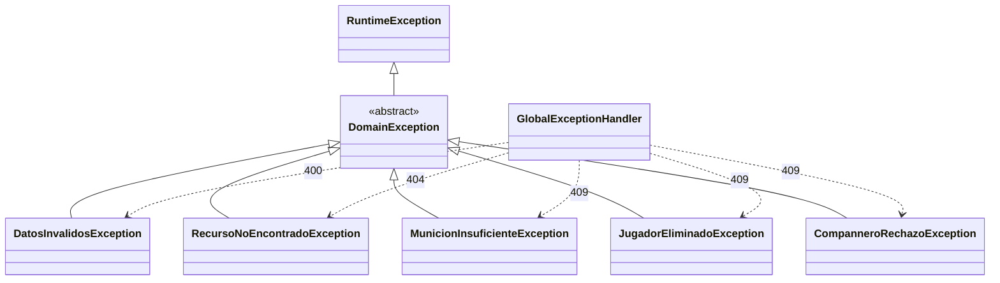

# Counter-Strike 2 (CS2) - API REST con persistencia

Proyecto de la cátedra **Lenguaje de Programación 3** (Universidad Católica
"Nuestra Señora de la Asunción"). Modela el dominio de armas y jugadores de
*Counter-Strike 2* aplicando POO, lo persiste con **JPA/Hibernate** y lo expone
mediante una **API REST** con **Spring Boot**.

- **Paquete base:** `py.edu.uc.lp3.mm.cs2`
- **Java:** 21
- **Spring Boot:** 4.1.1
- **Base de datos:** H2 persistente en archivo
- **Build:** Maven Wrapper (`bash ./mvnw`, no hace falta instalar Maven)

---

## Entregables cubiertos

| Requerimiento | Estado |
|---|---|
| Al menos 3 clases del dominio mapeadas con JPA | `Arma`, `ArmaDeFuego`, `Arrojadiza`, `Fusil`, `Pistola`, `Escopeta`, `AWP`, `Flash`, `Humo` y `Granada` usan herencia `SINGLE_TABLE`. |
| Entidad `Jugador` con nombre y vida inicial 100 | Implementada en `domain/Jugador.java`, con `recibirDisparo(int)` y persistencia JPA. |
| Entidad `Chaleco` con absorción de daño | Implementada en `domain/Chaleco.java`, asociada a `Jugador` con cascada JPA y durabilidad persistida. |
| Repositorio JPA de `Jugador` | `repository/JugadorRepository.java`. |
| Interfaz de dominio | `UICapable` (imagen, sonido, rango, velocidad) y `ArmaOfensiva` (daño); `UICapable` la implementan armas y `Jugador`. |
| CRUD REST de una familia | `ArmaCrudController`, `ArmaService`, `FusilService` y `GranadaService` con repositorios para el padre y dos hijas. |
| Endpoint de simulación | `POST /simulacion/disparar` descuenta munición, aplica el chaleco y actualiza la vida. |
| Reglas de negocio persistidas | `ValidadorService` y `SimulacionService` validan munición, chaleco, vida mínima 0 y estado de muerte; cada disparo queda en `simulaciones`. |
| Jerarquía de excepciones | `DomainException` + `DatosInvalidosException` + `RecursoNoEncontradoException` + `MunicionInsuficienteException` + `JugadorEliminadoException`. |
| `@RestControllerAdvice` | `GlobalExceptionHandler` con respuestas HTTP específicas, incluidos los 409 de negocio. |
| H2 lista para consola | URL fija `jdbc:h2:file:./data/cs2db;AUTO_SERVER=TRUE` y `/h2-console` habilitado. |
| Documentación | Este README, `BITACORA.md`, `Docs/ESPECIFICACIONES-POO-08.md` y colección de Insomnia. |
| OpenAPI propio | `/v3/api-docs` y `/swagger-ui.html` documentan CRUD, simulación, reglas y errores 400/404/409. |
| Clientes A2/A3 | `OpenApiOperationResolver` lee el OpenAPI ajeno y `CompaneroClient` resuelve y cachea la ruta por 5 minutos; prefiere la `base-url` configurada. |
| Escenario persistido | `POST /escenarios/disparo-coordinado` exige dos aprobaciones semánticas, guarda `EscenarioCoordinado` en H2 y respeta `idempotencyKey`. |
| Atribución de rechazo | `409` con `rechazadoPor`, `statusRemoto` y `cuerpoRemoto`; la base queda igual. |
| Compañero no disponible | `502`/`504` con `statusRemoto`, `cuerpoRemoto` y `traceId`; HTTP queda fuera de la transacción. |
| Concurrencia y entrada | `@Version` y revalidación antes de escribir; Bean Validation responde `400` con `traceId`. |

---

## Estado de la corrección de POO-08

La corrección de POO-08 **tuvo observaciones y todas están cerradas** en este
repositorio. No se vuelve a aplicar la rúbrica de 24; este ítem aporta los 3
puntos correspondientes a «observaciones cerradas».

| Observación del docente | Cierre aplicado | Commit |
|---|---|---|
| Validaciones y excepciones dentro del dominio | Movidas a `ValidadorService` y `SimulacionService`; las entidades ya no lanzan excepciones. | [`bd27f27`](https://github.com/MigueMedina/mmedina-tplp3-2026/commit/bd27f27b373aa44a5afceba6496b518581c59606) |
| `setVida` público en `Jugador` | Reemplazado por asignación privada; la vida se modifica sólo con `recibirDisparo()`. | [`bd27f27`](https://github.com/MigueMedina/mmedina-tplp3-2026/commit/bd27f27b373aa44a5afceba6496b518581c59606) |
| `setMunicionActual` e `id` expuestos | Sin setters públicos; el id lo asigna H2 y la munición cambia con mensajes del dominio. | [`bd27f27`](https://github.com/MigueMedina/mmedina-tplp3-2026/commit/bd27f27b373aa44a5afceba6496b518581c59606) |
| `Jugador` no implementaba `UICapable` | Ahora implementa la interfaz y aparece en `/ui-capables`. | [`bd27f27`](https://github.com/MigueMedina/mmedina-tplp3-2026/commit/bd27f27b373aa44a5afceba6496b518581c59606) |
| `/ui-capables` no leía la base | `UICapableService` recorre `ArmaRepository` y `JugadorRepository`. | [`bd27f27`](https://github.com/MigueMedina/mmedina-tplp3-2026/commit/bd27f27b373aa44a5afceba6496b518581c59606) |
| Diagrama Mermaid desactualizado | Reescrito con dominio, repositorios, services, controllers, excepciones y jugadores. | [`3679ff2`](https://github.com/MigueMedina/mmedina-tplp3-2026/commit/3679ff24a8404e23833b7a1a280ef9d0922ded55) |
| Enlace del commit sin completar | `Docs/ESPECIFICACIONES-POO-08.md` apunta al commit exacto de la corrección. | [`3679ff2`](https://github.com/MigueMedina/mmedina-tplp3-2026/commit/3679ff24a8404e23833b7a1a280ef9d0922ded55) |
| README y bitácora alineadas con las reglas en service | Textos actualizados después del refactor. | [`7be5449`](https://github.com/MigueMedina/mmedina-tplp3-2026/commit/7be5449c624766232fb2564b2bffa1a87945f794) |
| Errores de ortografía en Insomnia | Corregidos `despues` → `después` y `vacio` → `vacío`. | [`4d67d6d`](https://github.com/MigueMedina/mmedina-tplp3-2026/commit/4d67d6db45af73423a9f19791ad4cb8700940213) |

**Convención del enlace exacto de POO-09:** un commit no puede contener su propio
hash. El enlace de la solución se informa en Classroom y se replica en el README
apuntando al commit inmediatamente anterior al cierre documental; así el hash
publicado es verificable y no hay autorreferencia imposible.

---

## POO-09 — APIs cruzadas

Este repositorio es **A1**. A2 es Fabricio (`fg-taller-git-2026`) y A3 es
Joaquín (`jb-taller-git-2026`); ambos datos se pueden reemplazar con variables de
entorno sin tocar código.

| Rol | Dueño | URL base | OpenAPI | Regla que aporta |
|---|---|---|---|---|
| A1 | Este repo | `http://localhost:8080` | `http://localhost:8080/v3/api-docs` | Orquesta y persiste el escenario. |
| A2 | Fabricio G. | `A2_BASE_URL` / `http://localhost:8081` | `A2_OPENAPI_URL` / `http://localhost:8081/v3/api-docs` | `POST /api/reglas/municion` (`municion`) con `{cargador, balasPorDisparo, disparos}`. |
| A3 | Joaquín B. | `A3_BASE_URL` / `http://localhost:8082` | `A3_OPENAPI_URL` / `http://localhost:8082/v3/api-docs` | `POST /api/reglas/danio` (`danio`) con `{tirador, equipoTirador, objetivo, equipoObjetivo, vidaObjetivo, blindajeObjetivo, danio}`. |

**Escenario en una frase:** `POST /escenarios/disparo-coordinado` recibe
`{"jugadorId":1,"armaId":1,"equipoTirador":"TERRORISTAS","equipoObjetivo":"ANTITERRORISTAS","idempotencyKey":"escenario-001"}`
(los dos equipos son opcionales; la clave de idempotencia es obligatoria), consulta
A2 y A3 en ese orden y, sólo si los dos responden 2xx con `permitido:true`, dispara
y guarda en H2 la simulación junto con ambas aprobaciones. Repetir la misma
`idempotencyKey` devuelve la jugada ya persistida sin volver a consultar ni escribir.
Un `GET /escenarios/{id}` vuelve a leer la jugada. Si A2 o A3 rechazan, responde
`409` con `rechazadoPor` y ni `ESCENARIOS` ni `SIMULACIONES` cambian; si no responden,
responde `502`/`504` con `traceId`.

Las rutas ajenas se resuelven en runtime desde el OpenAPI de cada compañero.
Los `operationId` por defecto son `municion` (A2) y `danio` (A3), configurables
con `A2_OPERATION_ID` y `A3_OPERATION_ID`. El cliente lee también
`servers[0].url` del documento como fallback y prefiere la `base-url` configurada.
La ruta se cachea por rol, operación y URL durante 5 minutos; luego se resuelve de nuevo.

Para poder rotar y atender consultas como A2 o A3, este servicio también publica
sus dos reglas sin tocar H2: `GET /api/reglas`, `POST /api/reglas/municion` y
`POST /api/reglas/jugador-vivo`, con los `operationId` propios
`validarMunicion` y `validarJugadorVivo`. La ficha para compañeros está en
`Docs/doc-para-companeros.md`.

El enunciado aplicado, el detalle de los 15 puntos y los diagramas de flujo están
en `Docs/POO-09-enunciado-aplicado.md`.

### Captura reproducible contra servicios reales

Con A1, Fabricio (A2) y Joaquín (A3) levantados, ejecutar desde la raíz:

```bash
bash insomnia/capturar-respuestas.sh
```

El script recorre los tres OpenAPI, el catálogo de A1, los aliases, las reglas
directas de A2/A3, el escenario feliz, la repetición idempotente, los dos
rechazos y la validación 400. Guarda cada pedido y su respuesta real en
`insomnia/respuestas/capturas/*.json` y un índice en
`insomnia/respuestas/capturas/resumen.md`. Las URL y los commits se pueden
pisar con `A1_BASE_URL`, `A2_BASE_URL`, `A3_BASE_URL`, `A2_COMMIT` y
`A3_COMMIT`.

La corrida registrada el 25/11/2026 quedó con A1 `92bf30b` (working tree), A2
`d06bcf9` y A3 `ecba4ed`: 21 respuestas reales, escenario feliz `201`, repetición
con la misma `idempotencyKey` devolviendo el mismo id, rechazos `409` atribuidos
a A2 y A3, validación `400` con `campo`/`errores`/`traceId`, y la lista de
escenarios sin cambios después de los rechazos.

### Preguntas que pide el enunciado

- **OpenAPI:** vive en `/v3/api-docs` y se prueba en `/swagger-ui.html`. Incluye
  CRUD, simulación, escenario y errores 400/404/409 con descripciones y ejemplos.
- **Grupo:** A1 es este servicio, A2 es Fabricio y A3 es Joaquín. La tabla
  anterior registra URLs y reglas en una frase.
- **Escenario:** necesita munición (A2 `municion`) y un estado de objetivo
  aceptado por A3 (`danio` con vida y blindaje actuales) para que el disparo sea
  legal; el éxito se ve en `/escenarios` y en H2.
- **Cliente:** las URLs, los `operationId` y los nombres de campos se configuran
  por propiedades o variables de entorno; la ruta se lee del OpenAPI ajeno.
- **Errores:** se traducen a `CompanneroRechazoException`, se propician el
  código y cuerpo remotos, y el handler distingue `A2` de `A3`.

---

## Estructura del proyecto

```text
mmedina-tplp3-2026/
├── README.md
├── BITACORA.md
├── insomnia/
│   ├── capturar-respuestas.sh
│   ├── cs2-insomnia.json
│   ├── README.md
│   └── respuestas/
│       ├── capturas/
│       │   ├── resumen.md
│       │   └── *.json
│       ├── escenario-feliz.http
│       ├── rechazo-a2.http
│       ├── rechazo-a3.http
│       ├── companero-no-disponible.http
│       └── validacion-400.http
├── Docs/
│   ├── diagramamermaid.md
│   ├── ESPECIFICACIONES-POO-08.md
│   └── POO-09-enunciado-aplicado.md
└── cs2/
    ├── pom.xml
    ├── mvnw / mvnw.cmd
    └── src/
        ├── main/
        │   ├── java/py/edu/uc/lp3/mm/cs2/
        │   │   ├── Cs2Application.java
        │   │   ├── constants/ApiPaths.java
        │   │   ├── client/
        │   │   │   ├── ApiClientesProperties.java
        │   │   │   ├── ClientHttpConfig.java
        │   │   │   ├── CompaneroClient.java
        │   │   │   ├── OpenApiOperationResolver.java
        │   │   │   ├── ReglaRequest.java
        │   │   │   ├── RespuestaCompanero.java
        │   │   │   └── RolCompanero.java
        │   │   ├── domain/
        │   │   │   ├── Arma.java                 (@Entity, raíz SINGLE_TABLE)
        │   │   │   ├── ArmaDeFuego.java          (abstracta)
        │   │   │   ├── Arrojadiza.java           (abstracta)
        │   │   │   ├── ArmaOfensiva.java         (interfaz de daño)
        │   │   │   ├── UICapable.java            (interfaz de UI)
        │   │   │   ├── Fusil.java / Pistola.java / Escopeta.java / AWP.java
        │   │   │   ├── Flash.java / Humo.java / Granada.java
        │   │   │   ├── Jugador.java              (@Entity)
        │   │   │   ├── Chaleco.java              (@Entity, absorción de daño)
        │   │   │   ├── Simulacion.java           (@Entity, historial de disparos)
        │   │   │   └── EscenarioCoordinado.java  (@Entity, escenario POO-09)
        │   │   ├── exception/
        │   │   │   ├── DomainException.java
        │   │   │   ├── DatosInvalidosException.java
        │   │   │   ├── RecursoNoEncontradoException.java
        │   │   │   ├── MunicionInsuficienteException.java
        │   │   │   ├── JugadorEliminadoException.java
        │   │   │   └── CompanneroRechazoException.java
        │   │   ├── repository/
        │   │   │   ├── ArmaRepository.java
        │   │   │   ├── FusilRepository.java
        │   │   │   ├── GranadaRepository.java
        │   │   │   ├── JugadorRepository.java
        │   │   │   ├── SimulacionRepository.java
        │   │   │   └── EscenarioRepository.java
        │   │   ├── service/
        │   │   │   ├── ArmaMapper.java
        │   │   │   ├── ArmaService.java
        │   │   │   ├── FusilService.java
         │   │   │   ├── GranadaService.java
         │   │   │   ├── JugadorService.java
         │   │   │   ├── SimulacionService.java
         │   │   │   ├── UICapableService.java
         │   │   │   ├── ValidadorService.java
        │   │   │   └── EscenarioService.java
        │   │   └── rest/
        │   │       ├── advice/GlobalExceptionHandler.java
        │   │       ├── controller/
        │   │       │   ├── ArmaController.java        (endpoints POO existentes)
        │   │       │   ├── ArmaCrudController.java    (CRUD persistente)
        │   │       │   ├── JugadorController.java
        │   │       │   ├── SimulacionController.java
        │   │       │   ├── UIController.java
        │   │       │   ├── IndexController.java
        │   │       │   └── EscenarioController.java
        │   │       ├── dto/
        │   │       │   ├── ArmaRequest.java
        │   │       │   ├── DisparoRequest.java
        │   │       │   ├── JugadorRequest.java
        │   │       │   ├── JugadorResponse.java
        │   │       │   ├── SimulacionResponse.java
        │   │       │   ├── EscenarioRequest.java
        │   │       │   └── EscenarioResponse.java
        │   │       └── response/UIElementResponse.java
        │   └── resources/application.properties
        └── test/
            ├── resources/application.properties
            └── java/py/edu/uc/lp3/mm/cs2/...
```

---

## Diagrama Mermaid

```mermaid
classDiagram
    direction LR

    class Arma {
        <<abstract, @Entity>>
        -int id
        -String nombre
        -double precio
        +disparar() String
        +recargar() String
        +obtenerDetalleTienda() String
    }

    class ArmaDeFuego {
        <<abstract, @Entity>>
        -int dano
        -int precision
        -double recarga
        -double velocidad
        -int municionActual
        -int capacidadCargador
        -int cargadoresRestantes
        +getDano() int
        +getCargadoresRestantes() int
        +recargar() String
        +recargar(int) String
    }

    class Arrojadiza {
        <<abstract, @Entity>>
        -String tipo
        -double radio
        -double distancia
        -double duracion
        -double cooldown
    }

    class Fusil
    class Pistola
    class Escopeta
    class AWP
    class Flash
    class Humo
    class Granada

    class UICapable {
        <<interface>>
        +getImagen() String
        +getSonido() String
        +getVelocidadDisparo() double
        +getRango() double
        +mostrarEnUI() String
    }

    class ArmaOfensiva {
        <<interface>>
        +getDano() int
    }

    class Jugador {
        <<@Entity>>
        -Long id
        -String nombre
        -int vida
        -boolean vivo
        -Chaleco chaleco
        +recibirDisparo(int) int
        +equiparChaleco(Chaleco) void
        +getBlindaje() int
        +isVivo() boolean
        +revivir() void
    }

    class Chaleco {
        <<@Entity>>
        -Long id
        -int durabilidad
        +absorber(int) int
        +getDurabilidad() int
    }

    class Simulacion {
        <<@Entity>>
        -Long id
        -Jugador jugador
        -Arma arma
        -int dano
        -int vidaAntes
        -int vidaDespues
        -LocalDateTime fecha
    }

    class EscenarioCoordinado {
        <<@Entity>>
        -Long id
        -Simulacion simulacion
        -int a2Status
        -int a3Status
        -String a2Operacion
        -String a3Operacion
        -LocalDateTime fecha
    }

    class ArmaRepository {
        <<interface>>
        +findAllByOrderByIdAsc()
        +findByNombreContainingIgnoreCaseOrderByIdAsc(String)
    }
    class FusilRepository { <<interface>> }
    class GranadaRepository { <<interface>> }
    class JugadorRepository { <<interface>> }
    class SimulacionRepository { <<interface>> }
    class EscenarioRepository { <<interface>> }

    class ArmaCrudController
    class JugadorController
    class SimulacionController
    class UIController
    class EscenarioController
    class ArmaService
    class FusilService
    class GranadaService
    class JugadorService
    class SimulacionService
    class UICapableService
    class ValidadorService
    class EscenarioService

    class RolCompanero {
        <<enumeration>>
        A2
        A3
    }
    class OpenApiOperationResolver
    class CompaneroClient

    class DomainException {
        <<abstract>>
    }
    class DatosInvalidosException
    class RecursoNoEncontradoException
    class MunicionInsuficienteException
    class JugadorEliminadoException
    class CompanneroRechazoException
    class GlobalExceptionHandler

    Arma <|-- ArmaDeFuego
    Arma <|-- Arrojadiza
    ArmaDeFuego <|-- Fusil
    ArmaDeFuego <|-- Pistola
    ArmaDeFuego <|-- Escopeta
    ArmaDeFuego <|-- AWP
    Arrojadiza <|-- Flash
    Arrojadiza <|-- Humo
    Arrojadiza <|-- Granada

    UICapable <|.. Fusil
    UICapable <|.. AWP
    UICapable <|.. Flash
    UICapable <|.. Granada
    UICapable <|.. Jugador
    ArmaOfensiva <|.. ArmaDeFuego
    ArmaOfensiva <|.. Granada

    DomainException <|-- DatosInvalidosException
    DomainException <|-- RecursoNoEncontradoException
    DomainException <|-- MunicionInsuficienteException
    DomainException <|-- JugadorEliminadoException
    Jugador "0..1" o-- "1" Chaleco : usa

    Jugador "1" --> "*" Simulacion : participa
    Arma "1" --> "*" Simulacion : se usa en

    ArmaCrudController --> ArmaService
    ArmaCrudController --> FusilService
    ArmaCrudController --> GranadaService
    JugadorController --> JugadorService
    SimulacionController --> SimulacionService
    ArmaService --> ArmaRepository
    FusilService --> FusilRepository
    GranadaService --> GranadaRepository
    JugadorService --> JugadorRepository
    SimulacionService --> SimulacionRepository
    SimulacionService --> ArmaRepository
    SimulacionService --> JugadorRepository
    UIController --> UICapableService
    UICapableService --> ArmaRepository
    UICapableService --> JugadorRepository
    ArmaService --> ValidadorService
    FusilService --> ValidadorService
    GranadaService --> ValidadorService
    JugadorService --> ValidadorService
    SimulacionService --> ValidadorService
    GlobalExceptionHandler ..> DomainException

    Simulacion "1" --> "0..1" EscenarioCoordinado : se registra en
    EscenarioController --> EscenarioService
    EscenarioService --> EscenarioRepository
    EscenarioService --> SimulacionService
    EscenarioService --> CompaneroClient
    CompaneroClient --> OpenApiOperationResolver
    CompaneroClient --> RolCompanero
    DomainException <|-- CompanneroRechazoException
    EscenarioService ..> CompanneroRechazoException
    GlobalExceptionHandler ..> CompanneroRechazoException
```



La jerarquía de armas usa `@Inheritance(strategy = InheritanceType.SINGLE_TABLE)`,
una sola tabla `armas` y la columna discriminadora `tipo_arma`. En JSON, `Arma`
declara `@JsonTypeInfo` con la propiedad `tipoArma` y `@JsonSubTypes` para
`fusil`, `pistola`, `escopeta`, `awp`, `flash`, `humo` y `granada`.

---

## Reglas de negocio

Las validaciones, las reglas y las excepciones viven en la capa `service`
(`ValidadorService` y `SimulacionService`). Las entidades solo guardan el estado
encapsulado y responden a mensajes como `recibirDisparo()` o `recargar()`.

1. **Regla de munición:** `SimulacionService` comprueba el cargador antes de
   disparar; si no hay balas lanza `MunicionInsuficienteException` y la API
   responde 409. Cada disparo consume una bala de `municionActual`. Recargar, en
   cualquiera de sus sobrecargas, consume un cargador de repuesto; sin repuestos
   `ValidadorService` también responde 409.
2. **Regla del chaleco:** si el jugador tiene chaleco, absorbe el 50% del daño
   mientras le quede durabilidad. La durabilidad baja en la cantidad absorbida.
   El daño restante pasa a la vida.
3. **Regla de daño:** la vida del jugador nunca puede quedar por debajo de cero.
4. **Regla de estado:** si la vida llega a cero el jugador queda muerto y no
   admite más disparos; `SimulacionService` lanza
   `JugadorEliminadoException` (HTTP 409) antes de modificar el estado. Cada
   disparo actualiza al jugador, el arma y el chaleco, y se registra en
   `simulaciones`.

---

## Requisitos

- JDK 21 (`java -version`).
- No hace falta instalar Maven: el proyecto incluye `mvnw`.

---

## Cómo arrancar

Todos los comandos se ejecutan dentro de `cs2`:

```bash
cd cs2
```

Compilar:

```bash
bash ./mvnw clean compile
```

Ejecutar la aplicación:

```bash
bash ./mvnw spring-boot:run
```

La API queda en `http://localhost:8080`.

Alternativa con JAR:

```bash
bash ./mvnw clean package
java -jar target/cs2-0.0.1-SNAPSHOT.jar
```

Detener con `Ctrl + C`.

### Arrancar A1, A2 y A3

A1 es este repositorio:

```bash
cd cs2
bash ./mvnw spring-boot:run
```

A2 es Fabricio:

```bash
git clone https://github.com/FabricioG29/fg-taller-git-2026.git a2
cd a2
bash ./mvnw spring-boot:run -Dspring-boot.run.arguments=--server.port=8081
```

A3 es Joaquín:

```bash
git clone https://github.com/joaquinBenegas0/jb-taller-git-2026.git a3
cd a3
PORT=8082 bash ./mvnw spring-boot:run
```

Si los compañeros usan otros puertos, cambiar `A2_BASE_URL` y `A3_BASE_URL` en
el arranque de A1.

---

## Configuración de H2

Archivo: `cs2/src/main/resources/application.properties`.

| Propiedad | Valor | Explicación |
|---|---|---|
| `spring.application.name` | `cs2` | Nombre de la aplicación en logs, actuator y trazas. |
| `spring.datasource.url` | `jdbc:h2:file:./data/cs2db;AUTO_SERVER=TRUE` | URL fija y persistente. `./data/cs2db` es relativo a la carpeta `cs2`. `AUTO_SERVER=TRUE` permite que la consola web se conecte mientras corre la app. |
| `spring.datasource.driver-class-name` | `org.h2.Driver` | Driver JDBC de H2. |
| `spring.datasource.username` | `sa` | Usuario por defecto. |
| `spring.datasource.password` | *(vacío)* | Sin contraseña en desarrollo. |
| `spring.jpa.hibernate.ddl-auto` | `update` | Crea/actualiza las tablas automáticamente. |
| `spring.jpa.show-sql` | `true` | Muestra el SQL en consola para la defensa. |
| `spring.jpa.properties.hibernate.format_sql` | `true` | Formatea el SQL mostrado para que sea legible en la defensa. |
| `spring.jpa.open-in-view` | `false` | Evita mantener la sesión JPA abierta durante la serialización HTTP; obliga a resolver las relaciones dentro de la capa de servicio. |
| `spring.h2.console.enabled` | `true` | Habilita `/h2-console`. |
| `spring.h2.console.path` | `/h2-console` | Ruta de la consola. |
| `spring.h2.console.settings.web-allow-others` | `false` | Permite la consola solo desde la misma máquina, no desde otros equipos de la red. |
| `server.port` | `8080` | Puerto de la API. |

### Abrir la consola H2

1. Arrancar la aplicación.
2. Entrar a `http://localhost:8080/h2-console`.
3. Completar:
   - **JDBC URL:** `jdbc:h2:file:./data/cs2db;AUTO_SERVER=TRUE`
   - **User Name:** `sa`
   - **Password:** *(dejar vacío)*
4. Verificar las tablas `ARMAS`, `JUGADORES`, `CHALECOS` y `SIMULACIONES`.

> La carpeta `data/` se ignora en Git porque contiene la base local.

### Configuración de APIs cruzadas

| Propiedad / variable | Valor por defecto | Explicación |
|---|---|---|
| `apis.a2.base-url` / `A2_BASE_URL` | `http://localhost:8081` | URL base de Fabricio (A2). |
| `apis.a2.openapi-url` / `A2_OPENAPI_URL` | *(vacía)* | Si está vacía se deriva `/v3/api-docs`. |
| `apis.a2.operation-id` / `A2_OPERATION_ID` | `municion` | Operación buscada en el OpenAPI de A2. |
| `apis.a2.cuerpo.*` | `cargador`, `balasPorDisparo`, `disparos` | Nombres del JSON que espera `municion`. |
| `apis.a3.base-url` / `A3_BASE_URL` | `http://localhost:8082` | URL base de Joaquín (A3). |
| `apis.a3.openapi-url` / `A3_OPENAPI_URL` | *(vacía)* | Si está vacía se deriva `/v3/api-docs`. |
| `apis.a3.operation-id` / `A3_OPERATION_ID` | `danio` | Operación buscada en el OpenAPI de A3. |
| `apis.a3.cuerpo.*` | `tirador`, `equipoTirador`, `objetivo`, `equipoObjetivo`, `vidaObjetivo`, `blindajeObjetivo`, `danio` | Nombres del JSON que espera `danio`. |
| `apis.connect-timeout` / `APIS_CONNECT_TIMEOUT` | `2s` | Timeout de conexión hacia A2/A3. |
| `apis.read-timeout` / `APIS_READ_TIMEOUT` | `5s` | Timeout de respuesta hacia A2/A3; las respuestas se leen con buffering. |
| `springdoc.api-docs.path` | `/v3/api-docs` | Documento OpenAPI propio. |
| `springdoc.swagger-ui.path` | `/swagger-ui.html` | Swagger UI propio. |

Los nombres de los campos del JSON enviado a A2/A3 son configurables con
`apis.a2.cuerpo.*` y `apis.a3.cuerpo.*`, para adaptarse al cuerpo que publique
cada compañero sin modificar Java. Si falta alguno de esos mapeos, el cliente
falla rápido con un error de configuración en lugar de enviar un body incompleto.
La URL base configurada gana sobre el `servers[0].url` del OpenAPI ajeno.

### Mapa de `operationId` y payload entre A1, A2 y A3

| Dirección | `operationId` | Payload que envía A1 | Aceptación |
|---|---|---|---|
| A1 → A2 (Fabricio) | `municion` (`A2_OPERATION_ID`) | `cargador`, `balasPorDisparo`, `disparos` | 2xx con `permitido:true`; rechazo 409/422 se atribuye a A2. |
| A1 → A3 (Joaquín) | `danio` (`A3_OPERATION_ID`) | `tirador`, `equipoTirador`, `objetivo`, `equipoObjetivo`, `vidaObjetivo`, `blindajeObjetivo`, `danio` | 2xx con `permitido:true`; rechazo 409/422 se atribuye a A3. |
| Compañero → A1 como A2 | `municion` en `/api/companeros/municion` | `carga`, `dano` | Alias de `validarMunicion`; 200 si hay munición, 409 si no. |
| Compañero → A1 como A3 | `danio` en `/api/companeros/danio` | `vida`, `blindaje` | Alias de `validarJugadorVivo`; 200 si el objetivo puede recibir daño, 409 si ya murió. |

Las reglas propias originales siguen disponibles en `/api/reglas/municion`
(`operationId=validarMunicion`) y `/api/reglas/jugador-vivo`
(`operationId=validarJugadorVivo`). Los aliases existen para que un compañero
que configure `municion` y `danio` encuentre en A1 los mismos `operationId` que
A1 espera de A2 y A3, sin cambiar los contratos ya probados. `GET /api/catalogo`
publica las stats orientativas para elegir armas sin adivinar valores.

---

## Endpoints

### Endpoints de dominio POO

| Método | Ruta | Descripción |
|---|---|---|
| GET | `/` | Saludo de prueba. |
| GET | `/ui-capables` | Lista polimórfica de armas y jugadores persistentes que implementan `UICapable`. |
| GET | `/arma` | Crea un arma en memoria según `tipo` (sin persistir). |
| GET | `/arma/accion` | Devuelve un arma, su recarga y detalle de tienda. |

### CRUD persistente de armas

| Método | Ruta | Descripción | Código esperado |
|---|---|---|---|
| GET | `/armas` | Lista todas las armas (opcional `?nombre=AK`). | 200 |
| GET | `/armas/{id}` | Busca un arma. | 200 / 404 |
| POST | `/armas` | Crea un arma según `tipo`. | 201 / 400 |
| PUT | `/armas/{id}` | Actualiza un arma. | 200 / 404 / 400 |
| DELETE | `/armas/{id}` | Elimina un arma. | 204 / 404 |
| GET | `/armas/fusiles` | Lista solo fusiles. | 200 |
| GET | `/armas/fusiles/{id}` | Busca un fusil. | 200 / 404 |
| POST | `/armas/fusiles` | Crea un fusil. | 201 / 400 |
| PUT | `/armas/fusiles/{id}` | Actualiza un fusil. | 200 / 404 / 400 |
| DELETE | `/armas/fusiles/{id}` | Elimina un fusil. | 204 / 404 |
| GET | `/armas/granadas` | Lista solo granadas. | 200 |
| GET | `/armas/granadas/{id}` | Busca una granada. | 200 / 404 |
| POST | `/armas/granadas` | Crea una granada. | 201 / 400 |
| PUT | `/armas/granadas/{id}` | Actualiza una granada. | 200 / 404 / 400 |
| DELETE | `/armas/granadas/{id}` | Elimina una granada. | 204 / 404 |

### CRUD de jugadores

| Método | Ruta | Descripción | Código esperado |
|---|---|---|---|
| GET | `/jugadores` | Lista jugadores. | 200 |
| GET | `/jugadores/{id}` | Busca un jugador. | 200 / 404 |
| POST | `/jugadores` | Crea un jugador con vida 100 y blindaje opcional. | 201 / 400 |
| PUT | `/jugadores/{id}` | Cambia el nombre y/o el blindaje. | 200 / 404 / 400 |
| DELETE | `/jugadores/{id}` | Elimina un jugador. | 204 / 404 |

### Simulación

| Método | Ruta | Descripción | Código esperado |
|---|---|---|---|
| POST | `/simulacion/disparar` | Dispara un arma a un jugador. | 201 / 400 / 404 / 409 |
| GET | `/simulacion/historial` | Historial completo persistido. | 200 |
| GET | `/simulacion/historial/jugador/{jugadorId}` | Historial de un jugador. | 200 / 404 |

### APIs cruzadas y escenario POO-09

| Método | Ruta | Descripción | Código esperado |
|---|---|---|---|
| GET | `/v3/api-docs` | Documento OpenAPI 3 de A1. | 200 |
| GET | `/swagger-ui.html` | Swagger UI para importar/probar el contrato. | 200 |
| GET | `/api/catalogo` | Catálogo CS2 propio con stats orientativas. | 200 |
| POST | `/api/companeros/municion` | Alias con `operationId=municion` para compañeros. | 200 / 400 / 409 |
| POST | `/api/companeros/danio` | Alias con `operationId=danio` para compañeros. | 200 / 400 / 409 |
| POST | `/escenarios/disparo-coordinado` | Consulta A2 y A3; valida entrada, exige `permitido:true`, respeta `idempotencyKey` y persiste el escenario. | 201 / 400 / 404 / 409 / 502 / 504 |
| GET | `/escenarios` | Lista los escenarios aceptados y persistidos. | 200 |
| GET | `/escenarios/{id}` | Busca un escenario por id. | 200 / 404 |

Body del escenario:

```json
{"jugadorId":1,"armaId":1,"idempotencyKey":"escenario-001"}
```

Respuesta de rechazo de un compañero:

```json
{
  "excepcion": "CompanneroRechazoException",
  "mensaje": "Rechazo de A3 (HTTP 409)",
  "rechazadoPor": "A3",
  "statusRemoto": 409,
   "cuerpoRemoto": "{\"excepcion\":\"JugadorEliminadoException\"}"
}
```

Respuesta de compañero no disponible:

```json
{
  "excepcion": "CompaneroNoDisponibleException",
  "mensaje": "No se pudo consultar a A2",
  "rechazadoPor": "A2",
  "statusHttp": 502,
  "statusRemoto": 503,
  "cuerpoRemoto": "upstream unavailable",
  "traceId": "e8d3f1d0-1234-4c9a-9a2f-0de3e7f3f5b1"
}
```

Todos los errores están tipados en Swagger con `ErrorResponse`,
`ErrorValidacionResponse` y `ErrorCompaneroResponse`. Los de validación incluyen
`campo` y `errores`; los de compañero incluyen `rechazadoPor`, `statusRemoto`,
`cuerpoRemoto` y `statusHttp`; todos llevan `traceId`. Un parámetro de ruta con
tipo inválido responde `400` en vez de `500`.

---


## Ejemplos con curl

### Crear un jugador

```bash
curl -X POST http://localhost:8080/jugadores \
  -H "Content-Type: application/json" \
  -d '{"nombre":"Neo","blindaje":100}'
```

```json
{"id":1,"nombre":"Neo","vida":100,"blindaje":100,"vivo":true}
```

### Crear un fusil

```bash
curl -X POST http://localhost:8080/armas/fusiles \
  -H "Content-Type: application/json" \
  -d '{"nombre":"AK-47","precio":2700,"dano":36,"precision":75}'
```

```json
{
  "id": 1, "tipoArma": "fusil", "nombre": "AK-47", "precio": 2700.0,
  "dano": 36, "precision": 75, "capacidadCargador": 30,
  "municionActual": 30, "automatica": true, "mira": 2, "retroceso": 20,
  "silenciador": false, "imagen": "fusil_ak-47.png",
  "sonido": "fusil_disparo.ogg", "rango": 30.0, "velocidadDisparo": 10.0
}
```

> Algunos campos se muestran resumidos; la respuesta real incluye todos los
> getters de la entidad.

### Crear una granada

```bash
curl -X POST http://localhost:8080/armas/granadas \
  -H "Content-Type: application/json" \
  -d '{"nombre":"HE","dano":98,"radio":6,"aturdimiento":true}'
```

### Crear un arma usando el padre

```bash
curl -X POST http://localhost:8080/armas \
  -H "Content-Type: application/json" \
  -d '{"tipo":"awp","nombre":"AWP","dano":115}'
```

### Actualizar y eliminar

```bash
curl -X PUT http://localhost:8080/armas/fusiles/1 \
  -H "Content-Type: application/json" \
  -d '{"nombre":"AK-47 Redline","dano":40}'

curl -X DELETE http://localhost:8080/armas/fusiles/1
```

### Disparar

```bash
curl -X POST http://localhost:8080/simulacion/disparar \
  -H "Content-Type: application/json" \
  -d '{"jugadorId":1,"armaId":1}'
```

```json
{
  "id": 1,
  "jugadorId": 1,
  "jugador": "Neo",
  "vidaAntes": 100,
  "vidaDespues": 64,
  "danoAplicado": 36,
  "vivo": true,
  "armaId": 1,
  "arma": "AK-47",
  "tipoArma": "fusil",
  "dano": 36,
  "fecha": "2026-11-10T09:40:24.094988"
}
```

### Historial persistido

```bash
curl http://localhost:8080/simulacion/historial
curl http://localhost:8080/simulacion/historial/jugador/1
```

### Escenario coordinado con A2 y A3

```bash
curl -X POST http://localhost:8080/escenarios/disparo-coordinado \
  -H "Content-Type: application/json" \
  -d '{"jugadorId":1,"armaId":1,"equipoTirador":"TERRORISTAS","equipoObjetivo":"ANTITERRORISTAS","idempotencyKey":"escenario-001"}'

curl http://localhost:8080/escenarios
curl http://localhost:8080/escenarios/1

curl http://localhost:8080/api/catalogo
curl -X POST http://localhost:8080/api/companeros/municion \
  -H "Content-Type: application/json" \
  -d '{"carga":1,"dano":30}'
curl -X POST http://localhost:8080/api/companeros/danio \
  -H "Content-Type: application/json" \
  -d '{"vida":50,"blindaje":20}'
```

### Endpoint de la interfaz

```bash
curl http://localhost:8080/ui-capables
```

### Error 400: POST ilegal

```bash
curl -X POST http://localhost:8080/armas \
  -H "Content-Type: application/json" \
  -d '{"tipo":"fusil","nombre":"Malo","precio":-1}'
```

```json
{
  "timestamp": "2026-11-10T09:40:24.243427081",
  "status": 400,
  "error": "Bad Request",
  "excepcion": "DatosInvalidosException",
  "mensaje": "El precio debe ser no negativo",
  "path": "/armas"
}
```

### Error 404: id inexistente

```bash
curl http://localhost:8080/armas/99999
```

```json
{
  "timestamp": "2026-11-10T09:40:24.204046273",
  "status": 404,
  "error": "Not Found",
  "excepcion": "RecursoNoEncontradoException",
  "mensaje": "No existe un arma con id 99999",
  "path": "/armas/99999"
}
```

### Error 409: munición insuficiente

```bash
curl -X POST http://localhost:8080/simulacion/disparar \
  -H "Content-Type: application/json" \
  -d '{"jugadorId":1,"armaId":2}'
```

```json
{
  "timestamp": "2026-11-10T10:25:00",
  "status": 409,
  "error": "Conflict",
  "excepcion": "MunicionInsuficienteException",
  "mensaje": "Fusil sin municion no puede disparar: cargador insuficiente (0 balas, necesita 1)",
  "path": "/simulacion/disparar"
}
```

### Error 409: jugador eliminado

```bash
curl -X POST http://localhost:8080/simulacion/disparar \
  -H "Content-Type: application/json" \
  -d '{"jugadorId":2,"armaId":3}'
```

```json
{
  "timestamp": "2026-11-10T10:26:00",
  "status": 409,
  "error": "Conflict",
  "excepcion": "JugadorEliminadoException",
  "mensaje": "El jugador eliminado ya está muerto y no puede recibir más disparos",
  "path": "/simulacion/disparar"
}
```

---

## Manejo de excepciones



| Excepción | HTTP | Cuándo se usa |
|---|---|---|
| `DatosInvalidosException` | 400 Bad Request | Datos inválidos, precio negativo, arma sin daño, blindaje fuera de rango. |
| `RecursoNoEncontradoException` | 404 Not Found | Id de arma, fusil, granada o jugador inexistente. |
| `MunicionInsuficienteException` | 409 Conflict | El cargador no tiene balas o no quedan cargadores de repuesto. |
| `JugadorEliminadoException` | 409 Conflict | Se intenta disparar a un jugador con vida 0. |
| `CompanneroRechazoException` | 409 Conflict | A2 o A3 rechazó el escenario; `rechazadoPor` distingue el origen. |
| `DomainException` | 400 Bad Request | Cualquier otra excepción de la jerarquía no especializada. |

`GlobalExceptionHandler` devuelve siempre `timestamp`, `status`, `error`,
`excepcion`, `mensaje` y `path`. El campo `excepcion` lleva el nombre simple de
la clase lanzada, de modo que `MunicionInsuficienteException` y
`JugadorEliminadoException` se distinguen aunque ambas respondan 409. El handler
de `IllegalArgumentException` queda como respaldo, pero las reglas de la API
lanzan las excepciones de la jerarquía desde la capa service.

---

## Pruebas

```bash
cd cs2
bash ./mvnw clean test
```

Resultado verificado: `BUILD SUCCESS` con 71 tests, 0 fallas y 0 errores:

- arranque del contexto Spring,
- validaciones de `ValidadorService` sobre armas, jugadores, chalecos y recarga,
- estado inicial, herencia y mensajes del dominio de armas,
- consumo de munición, sobrecarga de `recargar()` y cargadores de repuesto,
- vida inicial, daño, muerte, absorción del chaleco y mensajes de `Jugador`,
- excepciones 409 lanzadas por `SimulacionService` y `ValidadorService`,
- persistencia real de la simulación, la munición y el blindaje (JPA + H2 en memoria para tests),
- discriminador `tipoArma` en la creación y el listado de armas,
- consultas stateless de munición y jugador vivo, con casos 200, 400 y 409,
- respuesta de `/ui-capables` leyendo armas y jugadores desde H2,
- cuerpo de error con el nombre de la excepción,
- respuestas HTTP 400, 404 y 409,
- generación del OpenAPI y presencia de paths, `operationId` y errores,
- resolución de rutas desde un OpenAPI simulado, uso de `servers` y caché con invalidación,
- bindeo real de `apis.a2.cuerpo.*` y `apis.a3.cuerpo.*` desde `application.properties`,
- properties de producción sin el typo `dano` y timeouts configurables,
- cliente HTTP contra un servidor real que respeta la `base-url` configurada,
- fail-fast de mapeos remotos y clasificación de errores 5xx como `CompaneroNoDisponibleException`,
- escenario feliz, rechazos A2/A3 y aprobación semántica `permitido` sin escrituras en H2,
- idempotencia por `idempotencyKey` y bloqueo optimista con `@Version`,
- integridad referencial que impide borrar una simulación con escenario asociado,
- endpoint HTTP del escenario con relectura, 400 de validación, 502 sin escrituras y 409 con `rechazadoPor`,
- catálogo CS2 estable expuesto por HTTP y aliases con los `operationId` `municion` y `danio`,
- errores tipados con `campo`/`errores`, `statusHttp`, `statusRemoto`, `cuerpoRemoto` y `traceId`,
- parámetro de ruta mal tipado convertido en 400.


Los tests usan `cs2/src/test/resources/application.properties` con una base H2
en memoria para no ensuciar la base de desarrollo.

---

## Documentación interactiva (Swagger UI)

Con la aplicación en ejecución:

- Swagger UI: `http://localhost:8080/swagger-ui.html`
- OpenAPI JSON: `http://localhost:8080/v3/api-docs`

El documento describe el CRUD, la simulación, las dos reglas de POO-08, el
escenario de POO-09 y sus errores. Las operaciones llevan `operationId`
estable y las respuestas 400/404/409 incluyen ejemplos de las excepciones,
para que un compañero pueda importar el contrato sin abrir el código Java.

---

## Colección de Insomnia

La colección versionada está en `insomnia/cs2-insomnia.json`.

Para importarla:

1. Abrir Insomnia.
2. Ir a **Application → Preferences → Data → Import Data → From File**
   (o **Import/Export → Import**).
3. Seleccionar `insomnia/cs2-insomnia.json`.
4. Elegir el workspace **CS2 - TP LP3**.
5. Verificar el environment **Base**:
   - `base_url` / `a1_base_url`: `http://localhost:8080`
   - `a2_base_url` y `a3_base_url`: `http://localhost:8081` (Fabricio) y
     `http://localhost:8082` (Joaquín).
   - `a2_openapi` y `a3_openapi`: documentos `/v3/api-docs` de los compañeros.
   - `jugador_id`, `arma_id`, `fusil_id`, `granada_id`: ids de prueba.
   - `arma_sin_municion_id`, `jugador_mortal_id`, `arma_letal_id`: ids que se
     copian de los POST de preparación de los casos 409.
6. Arrancar A1, A2 y A3 y ejecutar las carpetas en orden: `Armas`, `Fusiles`,
   `Granadas`, `Jugadores`, `Simulación`, `Interface`, `Excepciones`,
   `10 - POO-09 (APIs cruzadas)` y, por último, `Limpieza` para los DELETE.
7. Después de cada POST de creación, copiar el `id` devuelto en la variable de
   environment que corresponda. No ejecutar los DELETE antes de la simulación
   ni del escenario porque eliminan los recursos usados como ejemplo.

La colección incluye el CRUD completo, un POST ilegal seguido de un GET para
comprobar que la colección no creció, una consulta de id inexistente, el
endpoint `/ui-capables`, la simulación con disparo al jugador, un pedido para
`MunicionInsuficienteException` (409), otro para `JugadorEliminadoException`
(409) y los POST de preparación necesarios para reproducir ambos estados. La
carpeta `10 - POO-09 (APIs cruzadas)` agrega los OpenAPI de A1/A2/A3, el
escenario feliz, su relectura, los rechazos de A2 y A3 y el GET de comparación.
Los DELETE están agrupados en `09 - Limpieza`.

Las respuestas de ejemplo del feliz y de cada rechazo están en
`insomnia/respuestas/`. El recorrido completo y el orden de las excepciones
están detallados en `insomnia/README.md`.

---

## Sobrecarga y sobreescritura

La **sobrecarga** ocurre en una misma clase cuando hay varios métodos con el
mismo nombre y distinta lista de argumentos. Se agregó en `Arma` y sus hijas con
constructores simples y completos, y en `ArmaDeFuego` con `recargar()` para
llenar el cargador y `recargar(int cantidad)` para recargar una cantidad
parcial. Ambas sobrecargas consumen un cargador de repuesto; la variante con
cantidad agrega hasta lo pedido sin superar la capacidad del cargador. El
compilador elige la versión según los argumentos; no hay despacho polimórfico
entre clases.

La **sobreescritura** ocurre entre una superclase o interfaz y una subclase,
cuando se redefine el mismo método con la misma firma. `Arma` declara
`disparar()`, `recargar()` y `obtenerDetalleTienda()`; `Fusil`, `Pistola`,
`Escopeta`, `AWP`, `Flash`, `Humo` y `Granada` los implementan con su propio
comportamiento. `UICapable` declara `getImagen()`, `getSonido()`,
`getVelocidadDisparo()`, `getRango()` y `mostrarEnUI()`; `Flash` y `Granada`
sobrescriben `mostrarEnUI()` y `getVelocidadDisparo()`, mientras que las demás
armas usan el comportamiento heredado o lo especializan. En ejecución, una
variable de tipo `Arma` o `UICapable` llama al método de la instancia concreta.

En resumen: la sobrecarga se distingue por la lista de parámetros y se resuelve
al compilar; la sobreescritura se distingue por la misma firma y se resuelve en
tiempo de ejecución mediante el tipo real del objeto.

---

## Qué hay que pensar

**1. Recurso y verbo.** El sustantivo principal es `arma`; por eso las rutas
nombran recursos (`/armas`, `/armas/fusiles`, `/armas/granadas`, `/jugadores`) y
el verbo HTTP expresa la operación (`GET`, `POST`, `PUT`, `DELETE`). La ruta
`/simulacion/disparar` es una operación de negocio explícita: se expone como
`POST` porque crea un registro de simulación y modifica el estado del jugador y
del arma; no se usa un verbo en la URL.

**2. Identidad.** La clave es `id`: `int` en `Arma` y `Long` en `Jugador`,
`Chaleco` y `Simulacion`. La asigna H2 mediante
`@GeneratedValue(strategy = GenerationType.IDENTITY)`. El JSON de creación
—`ArmaRequest` o `JugadorRequest`— no lleva `id`; el cliente lo omite y lo lee
de la respuesta. La URL usa ese id de persistencia, nunca un índice de una lista
del controller.

**3. Herencia y tablas.** Se eligió `InheritanceType.SINGLE_TABLE` porque la
jerarquía de armas es cerrada, las consultas son polimórficas y se evita un
`JOIN` para listar todas las armas. La columna discriminadora es `tipo_arma`.
En JSON el subtipo se explicita con `@JsonTypeInfo(use = Id.NAME, include =
As.PROPERTY, property = "tipoArma")` y `@JsonSubTypes` en `Arma`; los nombres
son `fusil`, `pistola`, `escopeta`, `awp`, `flash`, `humo` y `granada`. Por eso
tanto la respuesta del POST como el `GET /armas` incluyen `tipoArma`. El campo
`tipo` de una `Arrojadiza` es un dato propio de la granada; no se confunde con el
discriminador de clase.

**4. Interfaz y repositorio.** `ArmaRepository` es una interfaz de Spring Data:
declara mensajes como `findAllByOrderByIdAsc()` o
`findByNombreContainingIgnoreCaseOrderByIdAsc(...)`, y Spring genera la
implementación. El controller y los servicios dependen de esa abstracción, no de
una implementación concreta; es la misma idea del protocolo de POO-07: se
programa contra el contrato y se puede cambiar la implementación sin tocar al
cliente.

**5. Protocolo del dominio.** `UICapable` declara imagen, sonido, velocidad,
rango y `mostrarEnUI()`. El endpoint de lectura es `GET /ui-capables`; el
controller devuelve `List<UICapable>` y cada elemento es un `UIElementResponse`
que implementa la interfaz, de modo que el contrato de retorno coincide con el
tipo de dominio. `UICapableService` recorre las armas y los jugadores guardados
en H2 y filtra los que implementan el protocolo. Lo implementan `Fusil` y `AWP`
desde la rama `ArmaDeFuego`, `Flash` y `Granada` desde la rama `Arrojadiza`, y
`Jugador` desde otra familia, así que el tipo de interfaz puede hablar con
instancias distintas del modelo. `ArmaOfensiva` es el otro protocolo: expone
`getDano()` y lo usa la simulación para aceptar armas que realmente infligen
daño.

**6. Ocultamiento e invariantes.** Los campos son privados y las reglas
numéricas se validan en `ValidadorService` y `SimulacionService` antes de
modificar el estado. Las entidades no lanzan excepciones: `ArmaDeFuego`
descuenta balas en `disparar()` y `recargar()`, `Jugador` responde a
`recibirDisparo()` y `Chaleco.absorber()` descuenta la durabilidad. `setVida`,
`setMunicionActual` e `id` no tienen setters públicos: la vida y la munición se
cambian con mensajes del juego y el id lo asigna la base. Los DTO de entrada
evitan que Jackson escriba directamente sobre las entidades. JPA e Hibernate
hidratan las filas por reflexión usando el constructor sin argumentos. Un POST
ilegal se rechaza antes de `save()`, por lo que la transacción no deja basura:
la colección de Insomnia incluye el POST con precio negativo y un GET posterior
para comparar el listado.

**7. PUT y PATCH.** La API usa `PUT` porque el proyecto ya tenía ese verbo y el
enunciado acepta `PUT` o `PATCH`. La semántica implementada es de actualización
parcial: `ArmaMapper.aplicar()` y `JugadorService.actualizar()` ignoran los
campos nulos u omitidos y conservan el valor persistido. No es un reemplazo
estricto del recurso completo; si se necesitara esa semántica, correspondería
`PATCH` o exigir todos los campos. El README y la colección documentan este
comportamiento para que no haya ambigüedad.

**8. DELETE.** Borrar significa eliminar físicamente la fila del arma o del
jugador. El endpoint responde `204 No Content`; un GET posterior responde `404`.
Las simulaciones son historial y se eliminan en cascada cuando se borra el
jugador o el arma asociada (`@OnDelete(CASCADE)`). El verbo HTTP no ejecuta una
regla de negocio del juego: delega en el repositorio; la decisión de permitir el
borrado y su efecto quedan documentados, no improvisados en el controller.

**9. Constructores y JPA.** `Arma`, `ArmaDeFuego`, `Arrojadiza`, `Jugador`,
`Simulacion`, `Chaleco` y todas las clases concretas tienen constructor sin
argumentos con visibilidad `protected` para que JPA pueda instanciarlos sin
exponerlos al cliente. Las clases concretas conservan constructores de negocio
públicos y sobrecargados: uno simple que crea un objeto con valores por defecto
y otro completo con todos los atributos. Hibernate usa el constructor vacío
protegido y completa los campos privados por reflexión; el código de la
aplicación usa los constructores de negocio y los servicios validan los datos
antes de persistir.

**10. Dos reglas y simulación.** La primera regla es de munición: cada disparo
descuenta una bala y recargar consume un cargador de repuesto. La segunda es de
daño con chaleco: el `Chaleco` absorbe hasta el 50% del daño según su
durabilidad, la vida nunca baja de cero y un jugador con vida 0 no admite otro
disparo. El recurso es `POST /simulacion/disparar`; participan `ArmaDeFuego`
(arma), `Jugador` y `Chaleco`, y además se persiste una `Simulacion` como
historial. Después de simular, `GET /jugadores/{id}` muestra vida y blindaje,
`GET /armas/{id}` muestra munición y `GET /simulacion/historial` muestra el
registro. Todo se ejecuta dentro de `@Transactional`.

**11. Excepciones.** `DomainException` es la base no comprobada.
`DatosInvalidosException` representa datos que rompen un invariante de
construcción o actualización (400). `RecursoNoEncontradoException` representa un
id que no existe (404). `MunicionInsuficienteException` y
`JugadorEliminadoException` representan reglas de juego incumplidas y responden
409. Un recurso inexistente y una regla de juego incumplida son tipos distintos
porque el cliente debe poder reaccionar distinto: corregir la URL o corregir el
estado del juego.

Se eligió **409 Conflict** y no 400 porque la petición está bien formada y los
recursos existen; lo que impide completarla es el estado actual (cargador vacío
o jugador con vida 0). Tampoco corresponde 404 porque el arma y el jugador
existen. Un 422 sería defendible, pero 409 expresa mejor un conflicto con el
estado del recurso y le indica al cliente que debe recargar el arma o dejar de
disparar al jugador eliminado.

**12. Excepciones comprobadas y no comprobadas.** Todas las excepciones del
dominio extienden `RuntimeException`, es decir, son no comprobadas. Se eligió así
porque una regla de negocio violada no se resuelve dentro del método que la
detecta: la maneja el `@RestControllerAdvice` y se traduce a HTTP. Una excepción
comprobada obligaría a declarar `throws` en cada servicio y controller, acoplaría
las firmas al transporte y no aportaría recuperación local. El handler de Spring
funciona con ambas, pero la no comprobada mantiene el dominio limpio.

**13. JSON de error.** `GlobalExceptionHandler` devuelve `timestamp`, `status`,
`error`, `excepcion`, `mensaje` y `path`. `excepcion` contiene el nombre simple
de la clase, por ejemplo `MunicionInsuficienteException` o
`JugadorEliminadoException`; de ese modo las dos hermanas 409 se distinguen por
el cuerpo aunque compartan el código HTTP.

**14. H2 y la consola.** La URL debe ser fija porque la consola web es un cliente
JDBC independiente y necesita apuntar a la misma base que la aplicación. Con
una URL aleatoria en memoria no se podría inspeccionar el estado persistido. La
consola se habilita en desarrollo y las tablas se crean con `ddl-auto=update`.

**15. Cambiar de base de datos.** Si mañana se reemplaza H2 por PostgreSQL o
MySQL cambian el driver, la URL, el usuario, la contraseña y posiblemente el
dialecto en `application.properties` y `pom.xml`. No cambian el dominio, los
repositorios Spring Data, los controllers, los DTO ni las reglas de negocio; esa
es la ventaja de mantener la persistencia detrás de interfaces.

**16. ¿Quién lanza la excepción?** La lanza la capa service, no el dominio ni el
controller. `ValidadorService` lanza `DatosInvalidosException` y
`MunicionInsuficienteException` cuando los datos o la recarga no son válidos;
`SimulacionService` lanza `MunicionInsuficienteException` y
`JugadorEliminadoException` antes de pedirle a las entidades que cambien su
estado. Las entidades solo guardan el estado encapsulado; el controller traduce
HTTP.

**17. ¿Por qué una entidad `Simulacion`?** Porque el jugador y el arma representan
el estado actual, mientras que `Simulacion` conserva el historial auditable de
cada disparo con vida antes/después, daño, arma, jugador y fecha. Así se puede
demostrar que la simulación persistió y no solo que la respuesta HTTP fue
correcta.

**18. ¿Por qué los tests usan H2 en memoria?** Para que sean rápidos, repetibles y
no dependan de archivos locales. La base de desarrollo sigue siendo persistente
en `./data/cs2db`; la de tests se configura en
`cs2/src/test/resources/application.properties`.

---

## Notas

- Los endpoints `/arma` y `/arma/accion` se conservan para la demostración de
  POO y no persisten datos; el CRUD persistente está en `/armas`.
- Las armas `Flash` y `Humo` no implementan `ArmaOfensiva`, por lo que no pueden
  usarse en `/simulacion/disparar` (responden 400).
- Si se modifica el esquema y H2 queda inconsistente, detener la aplicación y
  borrar la carpeta `cs2/data/` para recrear la base.

---

## Entrega POO-09

- POO-08: commit exacto de cierre de observaciones
  [`4d67d6d`](https://github.com/MigueMedina/mmedina-tplp3-2026/commit/4d67d6db45af73423a9f19791ad4cb8700940213).
- POO-09: enlace exacto al commit de la solución:
  [commit `0d93ffe`](https://github.com/MigueMedina/mmedina-tplp3-2026/commit/0d93ffe8f04f797e75ea76a3494dfc1d1190f7f6).

El enlace apunta al commit inmediatamente anterior al cierre documental, siguiendo
la convención de que un commit no puede contener su propio hash. El mismo enlace
se informa en Classroom.
