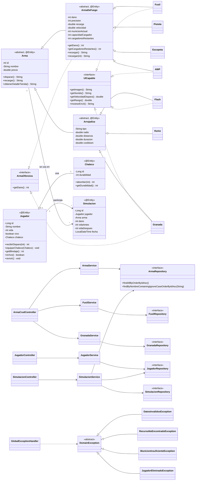
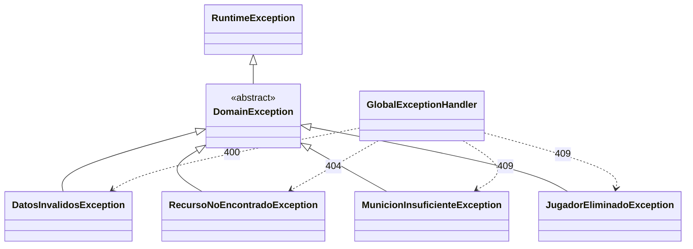

# Counter-Strike 2 (CS2) - API REST con persistencia

Proyecto de la cátedra **Lenguaje de Programación 3** (Universidad Católica
"Nuestra Señora de la Asunción"). Modela el dominio de armas y jugadores de
*Counter-Strike 2* aplicando POO, lo persiste con **JPA/Hibernate** y lo expone
mediante una **API REST** con **Spring Boot**.

- **Paquete base:** `py.edu.uc.lp3.mm.cs2`
- **Java:** 21
- **Spring Boot:** 4.1.1
- **Base de datos:** H2 persistente en archivo
- **Build:** Maven Wrapper (`./mvnw`, no hace falta instalar Maven)

---

## Entregables cubiertos

| Requerimiento | Estado |
|---|---|
| Al menos 3 clases del dominio mapeadas con JPA | `Arma`, `ArmaDeFuego`, `Arrojadiza`, `Fusil`, `Pistola`, `Escopeta`, `AWP`, `Flash`, `Humo` y `Granada` usan herencia `SINGLE_TABLE`. |
| Entidad `Jugador` con nombre y vida inicial 100 | Implementada en `domain/Jugador.java`, con `recibirDisparo(int)` y persistencia JPA. |
| Entidad `Chaleco` con absorción de daño | Implementada en `domain/Chaleco.java`, asociada a `Jugador` con cascada JPA y durabilidad persistida. |
| Repositorio JPA de `Jugador` | `repository/JugadorRepository.java`. |
| Interfaz de dominio | `UICapable` (imagen, sonido, rango, velocidad) y `ArmaOfensiva` (daño). |
| CRUD REST de una familia | `ArmaCrudController`, `ArmaService`, `FusilService` y `GranadaService` con repositorios para el padre y dos hijas. |
| Endpoint de simulación | `POST /simulacion/disparar` descuenta munición, aplica el chaleco y actualiza la vida. |
| Reglas de negocio persistidas | Munición real, absorción del chaleco, vida mínima 0 y estado de muerte; cada disparo queda en `simulaciones`. |
| Jerarquía de excepciones | `DomainException` + `DatosInvalidosException` + `RecursoNoEncontradoException` + `MunicionInsuficienteException` + `JugadorEliminadoException`. |
| `@RestControllerAdvice` | `GlobalExceptionHandler` con respuestas HTTP específicas, incluidos los 409 de negocio. |
| H2 lista para consola | URL fija `jdbc:h2:file:./data/cs2db;AUTO_SERVER=TRUE` y `/h2-console` habilitado. |
| Documentación | Este README, `BITACORA.md`, `Docs/ESPECIFICACIONES-POO-08.md` y colección de Insomnia. |

---

## Estructura del proyecto

```text
mmedina-tplp3-2026/
├── README.md
├── BITACORA.md
├── insomnia/
│   ├── cs2-insomnia.json
│   └── README.md
├── Docs/
│   ├── diagramamermaid.md
│   └── ESPECIFICACIONES-POO-08.md
└── cs2/
    ├── pom.xml
    ├── mvnw / mvnw.cmd
    └── src/
        ├── main/
        │   ├── java/py/edu/uc/lp3/mm/cs2/
        │   │   ├── Cs2Application.java
        │   │   ├── constants/ApiPaths.java
        │   │   ├── domain/
        │   │   │   ├── Arma.java                 (@Entity, raíz SINGLE_TABLE)
        │   │   │   ├── ArmaDeFuego.java          (abstracta)
        │   │   │   ├── Arrojadiza.java           (abstracta)
        │   │   │   ├── ArmaOfensiva.java         (interfaz de daño)
        │   │   │   ├── UICapable.java            (interfaz de UI)
        │   │   │   ├── Fusil.java / Pistola.java / Escopeta.java / AWP.java
        │   │   │   ├── Flash.java / Humo.java / Granada.java
        │   │   │   ├── Jugador.java              (@Entity)
        │   │   │   ├── Chaleco.java              (@Entity, absorción de daño)
        │   │   │   └── Simulacion.java           (@Entity, historial de disparos)
        │   │   ├── exception/
        │   │   │   ├── DomainException.java
        │   │   │   ├── DatosInvalidosException.java
        │   │   │   ├── RecursoNoEncontradoException.java
        │   │   │   ├── MunicionInsuficienteException.java
        │   │   │   └── JugadorEliminadoException.java
        │   │   ├── repository/
        │   │   │   ├── ArmaRepository.java
        │   │   │   ├── FusilRepository.java
        │   │   │   ├── GranadaRepository.java
        │   │   │   ├── JugadorRepository.java
        │   │   │   └── SimulacionRepository.java
        │   │   ├── service/
        │   │   │   ├── ArmaMapper.java
        │   │   │   ├── ArmaService.java
        │   │   │   ├── FusilService.java
        │   │   │   ├── GranadaService.java
        │   │   │   ├── JugadorService.java
        │   │   │   └── SimulacionService.java
        │   │   └── rest/
        │   │       ├── advice/GlobalExceptionHandler.java
        │   │       ├── controller/
        │   │       │   ├── ArmaController.java        (endpoints POO existentes)
        │   │       │   ├── ArmaCrudController.java    (CRUD persistente)
        │   │       │   ├── JugadorController.java
        │   │       │   ├── SimulacionController.java
        │   │       │   ├── UIController.java
        │   │       │   └── IndexController.java
        │   │       ├── dto/
        │   │       │   ├── ArmaRequest.java
        │   │       │   ├── DisparoRequest.java
        │   │       │   ├── JugadorRequest.java
        │   │       │   ├── JugadorResponse.java
        │   │       │   └── SimulacionResponse.java
        │   │       └── response/UIElementResponse.java
        │   └── resources/application.properties
        └── test/
            ├── resources/application.properties
            └── java/py/edu/uc/lp3/mm/cs2/...
```

---

## Diagrama Mermaid



La jerarquía de armas usa `@Inheritance(strategy = InheritanceType.SINGLE_TABLE)`,
una sola tabla `armas` y la columna discriminadora `tipo_arma`. En JSON, `Arma`
declara `@JsonTypeInfo` con la propiedad `tipoArma` y `@JsonSubTypes` para
`fusil`, `pistola`, `escopeta`, `awp`, `flash`, `humo` y `granada`.

---

## Reglas de negocio

1. **Regla de munición:** cada disparo descuenta una bala de `municionActual`.
   Si el cargador no tiene balas, el dominio lanza `MunicionInsuficienteException`
   y la API responde 409. Recargar, en cualquiera de sus sobrecargas, consume un
   cargador de repuesto; sin repuestos también se responde 409.
2. **Regla del chaleco:** si el jugador tiene chaleco, absorbe el 50% del daño
   mientras le quede durabilidad. La durabilidad baja en la cantidad absorbida.
   El daño restante pasa a la vida.
3. **Regla de daño:** la vida del jugador nunca puede quedar por debajo de cero.
4. **Regla de estado:** si la vida llega a cero el jugador queda muerto y no
   admite más disparos (`JugadorEliminadoException`, HTTP 409); cada disparo
   actualiza al jugador, el arma y el chaleco, y se registra en `simulaciones`.

---

## Requisitos

- JDK 21 (`java -version`).
- No hace falta instalar Maven: el proyecto incluye `mvnw`.

---

## Cómo arrancar

Todos los comandos se ejecutan dentro de `cs2`:

```bash
cd cs2
```

Compilar:

```bash
./mvnw clean compile
```

Ejecutar la aplicación:

```bash
./mvnw spring-boot:run
```

La API queda en `http://localhost:8080`.

Alternativa con JAR:

```bash
./mvnw clean package
java -jar target/cs2-0.0.1-SNAPSHOT.jar
```

Detener con `Ctrl + C`.

---

## Configuración de H2

Archivo: `cs2/src/main/resources/application.properties`.

| Propiedad | Valor | Explicación |
|---|---|---|
| `spring.application.name` | `cs2` | Nombre de la aplicación en logs, actuator y trazas. |
| `spring.datasource.url` | `jdbc:h2:file:./data/cs2db;AUTO_SERVER=TRUE` | URL fija y persistente. `./data/cs2db` es relativo a la carpeta `cs2`. `AUTO_SERVER=TRUE` permite que la consola web se conecte mientras corre la app. |
| `spring.datasource.driver-class-name` | `org.h2.Driver` | Driver JDBC de H2. |
| `spring.datasource.username` | `sa` | Usuario por defecto. |
| `spring.datasource.password` | *(vacío)* | Sin contraseña en desarrollo. |
| `spring.jpa.hibernate.ddl-auto` | `update` | Crea/actualiza las tablas automáticamente. |
| `spring.jpa.show-sql` | `true` | Muestra el SQL en consola para la defensa. |
| `spring.jpa.properties.hibernate.format_sql` | `true` | Formatea el SQL mostrado para que sea legible en la defensa. |
| `spring.jpa.open-in-view` | `false` | Evita mantener la sesión JPA abierta durante la serialización HTTP; obliga a resolver las relaciones dentro de la capa de servicio. |
| `spring.h2.console.enabled` | `true` | Habilita `/h2-console`. |
| `spring.h2.console.path` | `/h2-console` | Ruta de la consola. |
| `spring.h2.console.settings.web-allow-others` | `false` | Permite la consola solo desde la misma máquina, no desde otros equipos de la red. |
| `server.port` | `8080` | Puerto de la API. |

### Abrir la consola H2

1. Arrancar la aplicación.
2. Entrar a `http://localhost:8080/h2-console`.
3. Completar:
   - **JDBC URL:** `jdbc:h2:file:./data/cs2db;AUTO_SERVER=TRUE`
   - **User Name:** `sa`
   - **Password:** *(dejar vacío)*
4. Verificar las tablas `ARMAS`, `JUGADORES`, `CHALECOS` y `SIMULACIONES`.

> La carpeta `data/` se ignora en Git porque contiene la base local.

---

## Endpoints

### Endpoints de dominio POO

| Método | Ruta | Descripción |
|---|---|---|
| GET | `/` | Saludo de prueba. |
| GET | `/ui-capables` | Lista polimórfica de elementos `UICapable`. |
| GET | `/arma` | Crea un arma en memoria según `tipo` (sin persistir). |
| GET | `/arma/accion` | Devuelve un arma, su recarga y detalle de tienda. |

### CRUD persistente de armas

| Método | Ruta | Descripción | Código esperado |
|---|---|---|---|
| GET | `/armas` | Lista todas las armas (opcional `?nombre=AK`). | 200 |
| GET | `/armas/{id}` | Busca un arma. | 200 / 404 |
| POST | `/armas` | Crea un arma según `tipo`. | 201 / 400 |
| PUT | `/armas/{id}` | Actualiza un arma. | 200 / 404 / 400 |
| DELETE | `/armas/{id}` | Elimina un arma. | 204 / 404 |
| GET | `/armas/fusiles` | Lista solo fusiles. | 200 |
| GET | `/armas/fusiles/{id}` | Busca un fusil. | 200 / 404 |
| POST | `/armas/fusiles` | Crea un fusil. | 201 / 400 |
| PUT | `/armas/fusiles/{id}` | Actualiza un fusil. | 200 / 404 / 400 |
| DELETE | `/armas/fusiles/{id}` | Elimina un fusil. | 204 / 404 |
| GET | `/armas/granadas` | Lista solo granadas. | 200 |
| GET | `/armas/granadas/{id}` | Busca una granada. | 200 / 404 |
| POST | `/armas/granadas` | Crea una granada. | 201 / 400 |
| PUT | `/armas/granadas/{id}` | Actualiza una granada. | 200 / 404 / 400 |
| DELETE | `/armas/granadas/{id}` | Elimina una granada. | 204 / 404 |

### CRUD de jugadores

| Método | Ruta | Descripción | Código esperado |
|---|---|---|---|
| GET | `/jugadores` | Lista jugadores. | 200 |
| GET | `/jugadores/{id}` | Busca un jugador. | 200 / 404 |
| POST | `/jugadores` | Crea un jugador con vida 100 y blindaje opcional. | 201 / 400 |
| PUT | `/jugadores/{id}` | Cambia el nombre y/o el blindaje. | 200 / 404 / 400 |
| DELETE | `/jugadores/{id}` | Elimina un jugador. | 204 / 404 |

### Simulación

| Método | Ruta | Descripción | Código esperado |
|---|---|---|---|
| POST | `/simulacion/disparar` | Dispara un arma a un jugador. | 201 / 400 / 404 / 409 |
| GET | `/simulacion/historial` | Historial completo persistido. | 200 |
| GET | `/simulacion/historial/jugador/{jugadorId}` | Historial de un jugador. | 200 / 404 |

---

## Ejemplos con curl

### Crear un jugador

```bash
curl -X POST http://localhost:8080/jugadores \
  -H "Content-Type: application/json" \
  -d '{"nombre":"Neo","blindaje":100}'
```

```json
{"id":1,"nombre":"Neo","vida":100,"blindaje":100,"vivo":true}
```

### Crear un fusil

```bash
curl -X POST http://localhost:8080/armas/fusiles \
  -H "Content-Type: application/json" \
  -d '{"nombre":"AK-47","precio":2700,"dano":36,"precision":75}'
```

```json
{
  "id": 1, "tipoArma": "fusil", "nombre": "AK-47", "precio": 2700.0,
  "dano": 36, "precision": 75, "capacidadCargador": 30,
  "municionActual": 30, "automatica": true, "mira": 2, "retroceso": 20,
  "silenciador": false, "imagen": "fusil_ak-47.png",
  "sonido": "fusil_disparo.ogg", "rango": 30.0, "velocidadDisparo": 10.0
}
```

> Algunos campos se muestran resumidos; la respuesta real incluye todos los
> getters de la entidad.

### Crear una granada

```bash
curl -X POST http://localhost:8080/armas/granadas \
  -H "Content-Type: application/json" \
  -d '{"nombre":"HE","dano":98,"radio":6,"aturdimiento":true}'
```

### Crear un arma usando el padre

```bash
curl -X POST http://localhost:8080/armas \
  -H "Content-Type: application/json" \
  -d '{"tipo":"awp","nombre":"AWP","dano":115}'
```

### Actualizar y eliminar

```bash
curl -X PUT http://localhost:8080/armas/fusiles/1 \
  -H "Content-Type: application/json" \
  -d '{"nombre":"AK-47 Redline","dano":40}'

curl -X DELETE http://localhost:8080/armas/fusiles/1
```

### Disparar

```bash
curl -X POST http://localhost:8080/simulacion/disparar \
  -H "Content-Type: application/json" \
  -d '{"jugadorId":1,"armaId":1}'
```

```json
{
  "id": 1,
  "jugadorId": 1,
  "jugador": "Neo",
  "vidaAntes": 100,
  "vidaDespues": 64,
  "danoAplicado": 36,
  "vivo": true,
  "armaId": 1,
  "arma": "AK-47",
  "tipoArma": "fusil",
  "dano": 36,
  "fecha": "2026-11-10T09:40:24.094988"
}
```

### Historial persistido

```bash
curl http://localhost:8080/simulacion/historial
curl http://localhost:8080/simulacion/historial/jugador/1
```

### Endpoint de la interfaz

```bash
curl http://localhost:8080/ui-capables
```

### Error 400: POST ilegal

```bash
curl -X POST http://localhost:8080/armas \
  -H "Content-Type: application/json" \
  -d '{"tipo":"fusil","nombre":"Malo","precio":-1}'
```

```json
{
  "timestamp": "2026-11-10T09:40:24.243427081",
  "status": 400,
  "error": "Bad Request",
  "excepcion": "DatosInvalidosException",
  "mensaje": "El precio debe ser no negativo",
  "path": "/armas"
}
```

### Error 404: id inexistente

```bash
curl http://localhost:8080/armas/99999
```

```json
{
  "timestamp": "2026-11-10T09:40:24.204046273",
  "status": 404,
  "error": "Not Found",
  "excepcion": "RecursoNoEncontradoException",
  "mensaje": "No existe un arma con id 99999",
  "path": "/armas/99999"
}
```

### Error 409: munición insuficiente

```bash
curl -X POST http://localhost:8080/simulacion/disparar \
  -H "Content-Type: application/json" \
  -d '{"jugadorId":1,"armaId":2}'
```

```json
{
  "timestamp": "2026-11-10T10:25:00",
  "status": 409,
  "error": "Conflict",
  "excepcion": "MunicionInsuficienteException",
  "mensaje": "Fusil sin municion no puede disparar: cargador insuficiente (0 balas, necesita 1)",
  "path": "/simulacion/disparar"
}
```

### Error 409: jugador eliminado

```bash
curl -X POST http://localhost:8080/simulacion/disparar \
  -H "Content-Type: application/json" \
  -d '{"jugadorId":2,"armaId":3}'
```

```json
{
  "timestamp": "2026-11-10T10:26:00",
  "status": 409,
  "error": "Conflict",
  "excepcion": "JugadorEliminadoException",
  "mensaje": "El jugador eliminado ya está muerto y no puede recibir más disparos",
  "path": "/simulacion/disparar"
}
```

---

## Manejo de excepciones



| Excepción | HTTP | Cuándo se usa |
|---|---|---|
| `DatosInvalidosException` | 400 Bad Request | Datos inválidos, precio negativo, arma sin daño, blindaje fuera de rango. |
| `RecursoNoEncontradoException` | 404 Not Found | Id de arma, fusil, granada o jugador inexistente. |
| `MunicionInsuficienteException` | 409 Conflict | El cargador no tiene balas o no quedan cargadores de repuesto. |
| `JugadorEliminadoException` | 409 Conflict | Se intenta disparar a un jugador con vida 0. |
| `DomainException` | 400 Bad Request | Cualquier otra excepción de dominio no especializada. |
| `IllegalArgumentException` | 400 Bad Request | Invariantes heredados del dominio POO. |

`GlobalExceptionHandler` devuelve siempre `timestamp`, `status`, `error`,
`excepcion`, `mensaje` y `path`. El campo `excepcion` lleva el nombre simple de
la clase lanzada, de modo que `MunicionInsuficienteException` y
`JugadorEliminadoException` se distinguen aunque ambas respondan 409.

---

## Pruebas

```bash
cd cs2
./mvnw test
```

Resultado esperado: `BUILD SUCCESS` con 34 tests de:

- arranque del contexto Spring,
- invariantes del dominio de armas,
- consumo de munición, recarga y cargadores de repuesto,
- vida inicial, daño, muerte, absorción del chaleco e invalidaciones de `Jugador`,
- persistencia real de la simulación, la munición y el blindaje (JPA + H2 en memoria para tests),
- discriminador `tipoArma` en la creación y el listado de armas,
- respuesta de `/ui-capables` con el contrato de `UICapable`,
- cuerpo de error con el nombre de la excepción,
- respuestas HTTP 400, 404 y 409.

Los tests usan `cs2/src/test/resources/application.properties` con una base H2
en memoria para no ensuciar la base de desarrollo.

---

## Documentación interactiva (Swagger UI)

Con la aplicación en ejecución:

- Swagger UI: `http://localhost:8080/swagger-ui/index.html`
- OpenAPI JSON: `http://localhost:8080/v3/api-docs`

---

## Colección de Insomnia

La colección versionada está en `insomnia/cs2-insomnia.json`.

Para importarla:

1. Abrir Insomnia.
2. Ir a **Application → Preferences → Data → Import Data → From File**
   (o **Import/Export → Import**).
3. Seleccionar `insomnia/cs2-insomnia.json`.
4. Elegir el workspace **CS2 - TP LP3**.
5. Verificar el environment **Base**:
   - `base_url`: `http://localhost:8080`
   - `jugador_id`, `arma_id`, `fusil_id`, `granada_id`: ids de prueba.
   - `arma_sin_municion_id`, `jugador_mortal_id`, `arma_letal_id`: ids que se
     copian de los POST de preparación de los casos 409.
6. Arrancar la aplicación y ejecutar las carpetas en orden:
   `Armas`, `Fusiles`, `Granadas`, `Jugadores`, `Simulación`, `Interface`,
   `Excepciones` y, por último, `Limpieza` para los DELETE.
7. Después de cada POST de creación, copiar el `id` devuelto en la variable de
   environment que corresponda. No ejecutar los DELETE antes de la simulación
   porque eliminan los recursos usados como ejemplo.

La colección incluye el CRUD completo, un POST ilegal seguido de un GET para
comprobar que la colección no creció, una consulta de id inexistente, el
endpoint `/ui-capables`, la simulación con disparo al jugador, un pedido para
`MunicionInsuficienteException` (409), otro para `JugadorEliminadoException`
(409) y los POST de preparación necesarios para reproducir ambos estados. Los
DELETE están agrupados en `09 - Limpieza` para ejecutarlos después de la
simulación y de la revisión en H2.

El recorrido completo y el orden de las excepciones están detallados en
`insomnia/README.md`.

---

## Sobrecarga y sobreescritura

La **sobrecarga** ocurre en una misma clase cuando hay varios métodos con el
mismo nombre y distinta lista de argumentos. Se agregó en `Arma` y sus hijas con
constructores simples y completos, y en `ArmaDeFuego` con `recargar()` para
llenar el cargador y `recargar(int cantidad)` para recargar una cantidad
parcial. Ambas sobrecargas consumen un cargador de repuesto; la variante con
cantidad agrega hasta lo pedido sin superar la capacidad del cargador. El
compilador elige la versión según los argumentos; no hay despacho polimórfico
entre clases.

La **sobreescritura** ocurre entre una superclase o interfaz y una subclase,
cuando se redefine el mismo método con la misma firma. `Arma` declara
`disparar()`, `recargar()` y `obtenerDetalleTienda()`; `Fusil`, `Pistola`,
`Escopeta`, `AWP`, `Flash`, `Humo` y `Granada` los implementan con su propio
comportamiento. `UICapable` declara `getImagen()`, `getSonido()`,
`getVelocidadDisparo()`, `getRango()` y `mostrarEnUI()`; `Flash` y `Granada`
sobrescriben `mostrarEnUI()` y `getVelocidadDisparo()`, mientras que las demás
armas usan el comportamiento heredado o lo especializan. En ejecución, una
variable de tipo `Arma` o `UICapable` llama al método de la instancia concreta.

En resumen: la sobrecarga se distingue por la lista de parámetros y se resuelve
al compilar; la sobreescritura se distingue por la misma firma y se resuelve en
tiempo de ejecución mediante el tipo real del objeto.

---

## Qué hay que pensar

**1. Recurso y verbo.** El sustantivo principal es `arma`; por eso las rutas
nombran recursos (`/armas`, `/armas/fusiles`, `/armas/granadas`, `/jugadores`) y
el verbo HTTP expresa la operación (`GET`, `POST`, `PUT`, `DELETE`). La ruta
`/simulacion/disparar` es una operación de negocio explícita: se expone como
`POST` porque crea un registro de simulación y modifica el estado del jugador y
del arma; no se usa un verbo en la URL.

**2. Identidad.** La clave es `id`: `int` en `Arma` y `Long` en `Jugador`,
`Chaleco` y `Simulacion`. La asigna H2 mediante
`@GeneratedValue(strategy = GenerationType.IDENTITY)`. El JSON de creación
—`ArmaRequest` o `JugadorRequest`— no lleva `id`; el cliente lo omite y lo lee
de la respuesta. La URL usa ese id de persistencia, nunca un índice de una lista
del controller.

**3. Herencia y tablas.** Se eligió `InheritanceType.SINGLE_TABLE` porque la
jerarquía de armas es cerrada, las consultas son polimórficas y se evita un
`JOIN` para listar todas las armas. La columna discriminadora es `tipo_arma`.
En JSON el subtipo se explicita con `@JsonTypeInfo(use = Id.NAME, include =
As.PROPERTY, property = "tipoArma")` y `@JsonSubTypes` en `Arma`; los nombres
son `fusil`, `pistola`, `escopeta`, `awp`, `flash`, `humo` y `granada`. Por eso
tanto la respuesta del POST como el `GET /armas` incluyen `tipoArma`. El campo
`tipo` de una `Arrojadiza` es un dato propio de la granada; no se confunde con el
discriminador de clase.

**4. Interfaz y repositorio.** `ArmaRepository` es una interfaz de Spring Data:
declara mensajes como `findAllByOrderByIdAsc()` o
`findByNombreContainingIgnoreCaseOrderByIdAsc(...)`, y Spring genera la
implementación. El controller y los servicios dependen de esa abstracción, no de
una implementación concreta; es la misma idea del protocolo de POO-07: se
programa contra el contrato y se puede cambiar la implementación sin tocar al
cliente.

**5. Protocolo del dominio.** `UICapable` declara imagen, sonido, velocidad,
rango y `mostrarEnUI()`. El endpoint de lectura es `GET /ui-capables`; el
controller devuelve `List<UICapable>` y cada elemento es un `UIElementResponse`
que implementa la interfaz, de modo que el contrato de retorno coincide con el
tipo de dominio. Lo implementan `Fusil` y `AWP` desde la rama `ArmaDeFuego`, y
`Flash` y `Granada` desde la rama `Arrojadiza`, así que el tipo de interfaz
puede hablar con instancias de dos familias del modelo. `ArmaOfensiva` es el
otro protocolo: expone `getDano()` y lo usa la simulación para aceptar armas que
realmente infligen daño.

**6. Ocultamiento e invariantes.** Las reglas numéricas viven en el dominio:
`ArmaDeFuego.consumirMunicion()` y `recargar()` controlan balas, cargador y
repuestos; `Jugador.recibirDisparo()` controla vida y muerte; `Chaleco.absorber()`
controla durabilidad y absorción. Los DTO de entrada evitan que Jackson escriba
directamente sobre las entidades. Los setters públicos validan rangos y rechazan
valores negativos, y los campos son privados. JPA e Hibernate hidratan las filas
por reflexión usando el constructor sin argumentos, no los setters de negocio.
Un POST ilegal se rechaza antes de `save()`, por lo que la transacción no deja
basura: la colección de Insomnia incluye el POST con precio negativo y un GET
posterior para comparar el listado.

**7. PUT y PATCH.** La API usa `PUT` porque el proyecto ya tenía ese verbo y el
enunciado acepta `PUT` o `PATCH`. La semántica implementada es de actualización
parcial: `ArmaMapper.aplicar()` y `JugadorService.actualizar()` ignoran los
campos nulos u omitidos y conservan el valor persistido. No es un reemplazo
estricto del recurso completo; si se necesitara esa semántica, correspondería
`PATCH` o exigir todos los campos. El README y la colección documentan este
comportamiento para que no haya ambigüedad.

**8. DELETE.** Borrar significa eliminar físicamente la fila del arma o del
jugador. El endpoint responde `204 No Content`; un GET posterior responde `404`.
Las simulaciones son historial y se eliminan en cascada cuando se borra el
jugador o el arma asociada (`@OnDelete(CASCADE)`). El verbo HTTP no ejecuta una
regla de negocio del juego: delega en el repositorio; la decisión de permitir el
borrado y su efecto quedan documentados, no improvisados en el controller.

**9. Constructores y JPA.** `Arma`, `ArmaDeFuego`, `Arrojadiza`, `Jugador`,
`Simulacion`, `Chaleco` y todas las clases concretas tienen constructor sin
argumentos con visibilidad `protected` para que JPA pueda instanciarlos sin
exponerlos al cliente. Las clases concretas conservan constructores de negocio
públicos y sobrecargados: uno simple que crea un objeto legal con valores por
defecto y otro completo con todos los atributos. Hibernate usa el constructor
vacío protegido y completa los campos privados por reflexión; el código de la
aplicación usa los constructores de negocio y los setters validados.

**10. Dos reglas y simulación.** La primera regla es de munición: cada disparo
descuenta una bala y recargar consume un cargador de repuesto. La segunda es de
daño con chaleco: el `Chaleco` absorbe hasta el 50% del daño según su
durabilidad, la vida nunca baja de cero y un jugador con vida 0 no admite otro
disparo. El recurso es `POST /simulacion/disparar`; participan `ArmaDeFuego`
(arma), `Jugador` y `Chaleco`, y además se persiste una `Simulacion` como
historial. Después de simular, `GET /jugadores/{id}` muestra vida y blindaje,
`GET /armas/{id}` muestra munición y `GET /simulacion/historial` muestra el
registro. Todo se ejecuta dentro de `@Transactional`.

**11. Excepciones.** `DomainException` es la base no comprobada.
`DatosInvalidosException` representa datos que rompen un invariante de
construcción o actualización (400). `RecursoNoEncontradoException` representa un
id que no existe (404). `MunicionInsuficienteException` y
`JugadorEliminadoException` representan reglas de juego incumplidas y responden
409. Un recurso inexistente y una regla de juego incumplida son tipos distintos
porque el cliente debe poder reaccionar distinto: corregir la URL o corregir el
estado del juego.

Se eligió **409 Conflict** y no 400 porque la petición está bien formada y los
recursos existen; lo que impide completarla es el estado actual (cargador vacío
o jugador con vida 0). Tampoco corresponde 404 porque el arma y el jugador
existen. Un 422 sería defendible, pero 409 expresa mejor un conflicto con el
estado del recurso y le indica al cliente que debe recargar el arma o dejar de
disparar al jugador eliminado.

**12. Excepciones comprobadas y no comprobadas.** Todas las excepciones del
dominio extienden `RuntimeException`, es decir, son no comprobadas. Se eligió así
porque una regla de negocio violada no se resuelve dentro del método que la
detecta: la maneja el `@RestControllerAdvice` y se traduce a HTTP. Una excepción
comprobada obligaría a declarar `throws` en cada servicio y controller, acoplaría
las firmas al transporte y no aportaría recuperación local. El handler de Spring
funciona con ambas, pero la no comprobada mantiene el dominio limpio.

**13. JSON de error.** `GlobalExceptionHandler` devuelve `timestamp`, `status`,
`error`, `excepcion`, `mensaje` y `path`. `excepcion` contiene el nombre simple
de la clase, por ejemplo `MunicionInsuficienteException` o
`JugadorEliminadoException`; de ese modo las dos hermanas 409 se distinguen por
el cuerpo aunque compartan el código HTTP.

**14. H2 y la consola.** La URL debe ser fija porque la consola web es un cliente
JDBC independiente y necesita apuntar a la misma base que la aplicación. Con
una URL aleatoria en memoria no se podría inspeccionar el estado persistido. La
consola se habilita en desarrollo y las tablas se crean con `ddl-auto=update`.

**15. Cambiar de base de datos.** Si mañana se reemplaza H2 por PostgreSQL o
MySQL cambian el driver, la URL, el usuario, la contraseña y posiblemente el
dialecto en `application.properties` y `pom.xml`. No cambian el dominio, los
repositorios Spring Data, los controllers, los DTO ni las reglas de negocio; esa
es la ventaja de mantener la persistencia detrás de interfaces.

**16. ¿Quién lanza la excepción?** La lanza el objeto del dominio, no el
controller. `ArmaDeFuego.consumirMunicion()` lanza
`MunicionInsuficienteException`; `Jugador.recibirDisparo()` lanza
`JugadorEliminadoException`. El servicio solo busca las entidades y coordina la
transacción; el controller solo traduce HTTP.

**17. ¿Por qué una entidad `Simulacion`?** Porque el jugador y el arma representan
el estado actual, mientras que `Simulacion` conserva el historial auditable de
cada disparo con vida antes/después, daño, arma, jugador y fecha. Así se puede
demostrar que la simulación persistió y no solo que la respuesta HTTP fue
correcta.

**18. ¿Por qué los tests usan H2 en memoria?** Para que sean rápidos, repetibles y
no dependan de archivos locales. La base de desarrollo sigue siendo persistente
en `./data/cs2db`; la de tests se configura en
`cs2/src/test/resources/application.properties`.

---

## Notas

- Los endpoints `/arma` y `/arma/accion` se conservan para la demostración de
  POO y no persisten datos; el CRUD persistente está en `/armas`.
- Las armas `Flash` y `Humo` no implementan `ArmaOfensiva`, por lo que no pueden
  usarse en `/simulacion/disparar` (responden 400).
- Si se modifica el esquema y H2 queda inconsistente, detener la aplicación y
  borrar la carpeta `cs2/data/` para recrear la base.
